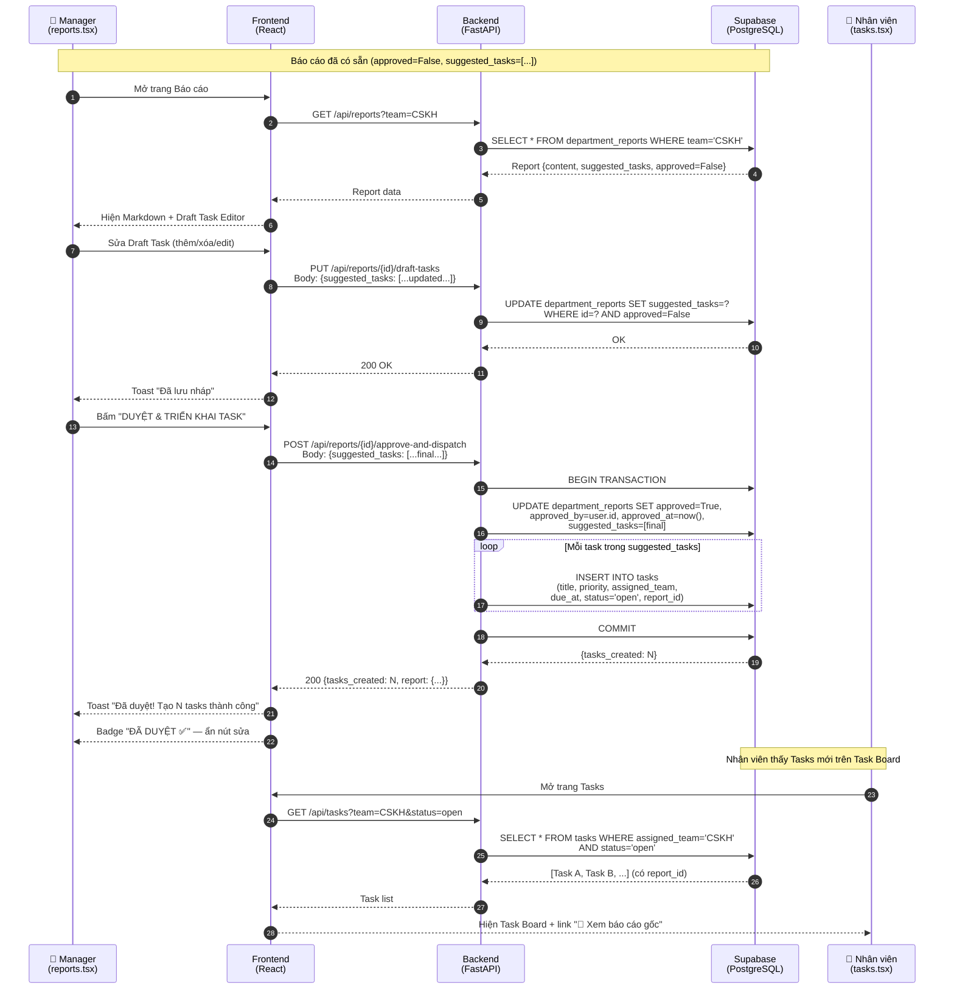

# Kế hoạch Triển khai: Luồng Khép kín HI-Loop Approval
## AI Quality Intelligence Platform — greenSM
### (Cập nhật theo nhánh main mới nhất — 25/06/2026)

---

## 1. Bài toán & Mục tiêu

Hệ thống hiện tại đã có luồng tự động từ Feedback → Ticket → Phân tích → Báo cáo Markdown.
Vấn đề: **Báo cáo AI chỉ là văn bản tĩnh — Manager đọc rồi phải tự tạo task thủ công, không có cầu nối tự động.**

**Mục tiêu của kế hoạch này:** Xây dựng cơ chế **Manager-in-the-Loop** — AI đề xuất Draft Tasks trong báo cáo, Manager chỉnh sửa rồi bấm một nút → Tasks chính thức tự động được phân rã và giao cho nhân viên xử lý.

---

## 2. Luồng End-to-End Mới (E2E Flow)

### 2.1 Sơ đồ tổng quát

```
┌─────────────────────────────────────────────────────────────────────────────┐
│                    LUỒNG KHÉP KÍN HI-LOOP APPROVAL                          │
│                  (Feedback → Report → Manager → Tasks)                      │
└─────────────────────────────────────────────────────────────────────────────┘

  [Khách hàng]
       │  Gửi phản hồi (App / CH Play / App Store)
       ▼
  ┌─────────────────────────────────────────────────┐
  │  GIAI ĐOẠN 1: TIẾP NHẬN & PHÂN LOẠI (Tự động)  │
  └─────────────────────────────────────────────────┘
       │
       ▼
  [Ingestion Agent]
  · Làm sạch PII
  · Phân loại: Topic / Sentiment / Severity (P1–P5)
  · Lưu vào bảng: feedback
       │
       ▼
  [Spike Detector]
  · Gom nhóm feedback theo (team, area, topic)
  · Phát hiện cụm bất thường (spike)
  · Sinh Ticket (Alert) định tuyến về đúng phòng ban
  · Lưu vào bảng: alerts (assigned_team, priority, sla_due_at)
       │
       ▼
  [Task Agent]
  · Gom các Alert chưa có task_id theo (team, area)
  · Tạo Task gom cụm (LLM 1 lần / cụm mới)
  · Lưu vào bảng: tasks (status=open, task_id gán vào alert)

  ┌─────────────────────────────────────────────────┐
  │  GIAI ĐOẠN 2: PHÂN TÍCH AI & SINH BÁO CÁO      │
  └─────────────────────────────────────────────────┘
       │
       ▼
  [Insight Agent]  (chạy cho từng phòng: IT, CSKH, Vận hành, Marketing)
  · Tổng hợp metrics: severity_distribution, top_topics, top_areas
  · Output: insights dict
       │
       ▼
  [Analyst Agent]
  · Phân tích root-cause bằng LLM với persona chuyên biệt theo phòng
  · Trả về: root_cause_summary (TEXT) + action_items (JSON, max 5)
  · Schema ActionItem: { id, action, priority, deadline, owner, success_metric }
       │
       ▼
  [Report Builder]
  · Render Markdown báo cáo (content)
  · [MỚI] Ghi thêm vào DB:
    - suggested_tasks (JSONB) ← action_items đã chuẩn hóa
    - root_cause_summary (TEXT)
  · Lưu vào bảng: department_reports (approved=False)

  ┌─────────────────────────────────────────────────┐
  │  GIAI ĐOẠN 3: MANAGER ĐÁNH GIÁ & DUYỆT         │  ← LUỒNG MỚI
  └─────────────────────────────────────────────────┘
       │
       ▼
  [Manager — Trang Reports]
  · Đọc báo cáo Markdown + danh sách Draft Tasks (từ cột suggested_tasks)
  · Thêm / Sửa / Xóa các Draft Task tùy ý
  · Lưu nháp → PUT /api/reports/{id}/draft-tasks
       │
       ▼
  [Manager bấm: "DUYỆT & TRIỂN KHAI TASK"]
       │
       ▼
  [API: POST /api/reports/{id}/approve-and-dispatch]  ← API MỚI
  · Cập nhật department_reports: approved=True, approved_by, approved_at
  · Với mỗi item trong suggested_tasks cuối cùng:
    → Tạo record trong bảng tasks:
       title = action, priority, assigned_team = phòng báo cáo
       due_at = now() + parse(deadline)  ["1h","24h","48h","1w"]
       status = "open", report_id = report.id   ← LIÊN KẾT MỚI
  · Báo cáo bị LOCK: không sửa draft được nữa

  ┌─────────────────────────────────────────────────┐
  │  GIAI ĐOẠN 4: NHÂN VIÊN XỬ LÝ TASK             │
  └─────────────────────────────────────────────────┘
       │
       ▼
  [Nhân viên — Trang Tasks]
  · Nhìn thấy Task mới (status=open) trên Task Board
  · [MỚI] Có link "📄 Xem báo cáo gốc" → biết lý do và ngữ cảnh
  · Nhận việc (tự assign hoặc Manager gán)
  · Thực hiện xử lý thực tế (fix bug / đào tạo tài xế / phản hồi KH…)
  · Cập nhật status: open → in_progress → resolved
       │
       ▼
  [Kết thúc chu trình]
  · Task resolved → Pipeline kỳ sau sẽ thấy số task quá hạn giảm
  · Feedback tiêu cực cùng chủ đề giảm → Hệ thống tự học theo thời gian
```

### 2.2 Sequence Diagram chi tiết (Giai đoạn 3 — HI-Loop mới)



### 2.3 Sơ đồ dữ liệu (Data Model thay đổi)

```
department_reports
├── id (UUID PK)
├── team (TEXT)                         ← IT | CSKH | Vận hành | Marketing
├── report_date (DATE)
├── content (TEXT)                      ← Markdown báo cáo (đã có)
├── approved (BOOLEAN)                  ← đã có
├── approved_by (UUID → auth.users)     ← đã có
├── approved_at (TIMESTAMPTZ)           ← đã có
├── suggested_tasks (JSONB) ◄── [MỚI]  ← Danh sách Draft Tasks
└── root_cause_summary (TEXT) ◄── [MỚI] ← Tóm tắt nguyên nhân gốc rễ

tasks
├── id (UUID PK)
├── title, summary, assigned_team, topic, area
├── priority, status, due_at, owner_id
├── created_at, updated_at
└── report_id (UUID → department_reports) ◄── [MỚI]  ← Liên kết nguồn gốc

alerts
├── id, title, description, severity, status
├── assigned_team, area, topic, priority, sla_due_at
└── task_id (UUID → tasks)              ← đã có
```

---

## 3. Hiện trạng Codebase & Gap Analysis

### ✅ Đã có sẵn

| Component | File |
|---|---|
| Bảng `department_reports` + approval fields | Migrations tới `20260625_...` |
| Bảng `tasks` với đầy đủ fields | `20260616120000_tasks_and_reports.sql` |
| `GET /api/reports` | `pipeline/main.py:L389` |
| `PATCH /api/reports/{id}/approve` | `pipeline/main.py:L417` |
| `GET /api/tasks`, task status/assign | `pipeline/main.py:L257–L353` |
| `analyst_agent` → `action_items` JSON theo schema `ActionItem` | `pipeline/agents/analyst_agent.py` |
| `report_builder.store_department_report()` | `pipeline/agents/report_builder.py:L182` |
| `orchestrator` chạy pipeline 7 bước | `pipeline/agents/orchestrator.py` |
| 4 phòng ban: IT, CSKH, Vận hành, Marketing | `pipeline/departments.py` |
| `reports.tsx` UI xem báo cáo + nút Duyệt đơn giản | `app/src/routes/_authenticated/reports.tsx` |
| `tasks.tsx` UI đầy đủ: filter, assign, status | `app/src/routes/_authenticated/tasks.tsx` |

### ❌ Còn thiếu (Gap Analysis)

| Gap | Mô tả | Ảnh hưởng |
|---|---|---|
| Cột `suggested_tasks` (JSONB) | AI ghi vào Markdown, chưa ghi JSON cấu trúc | Manager không thể edit từng task |
| Cột `root_cause_summary` (TEXT) | Nhúng trong Markdown, không tách riêng | Không query/hiển thị riêng được |
| Cột `report_id` (UUID FK) trên `tasks` | Không biết Task đến từ báo cáo nào | Nhân viên mất ngữ cảnh |
| `report_builder` ghi JSONB | `store_department_report()` chỉ ghi `content` | Chuỗi dữ liệu bị đứt |
| `PUT /api/reports/{id}/draft-tasks` | Chưa có | Manager không lưu được bản nháp |
| `POST /api/reports/{id}/approve-and-dispatch` | Chưa có (hiện có `PATCH /approve` nhưng không dispatch tasks) | Thiếu cầu nối tự động |
| UI Draft Task Editor trên `reports.tsx` | Chưa có | Manager phải tạo task thủ công |
| Link Report → Tasks trên `tasks.tsx` | Chưa có `report_id` field | Nhân viên không biết ngữ cảnh |

---

## 4. Architecture Decisions

- **Không thay thế endpoint `PATCH /api/reports/{id}/approve`** — giữ lại để backward compatibility.
- **`approve-and-dispatch` là atomic:** Dùng try/except bọc toàn bộ INSERT tasks. Nếu lỗi ở giữa, rollback trạng thái `approved` về `False`.
- **`suggested_tasks` bị LOCK sau khi duyệt:** `PUT /draft-tasks` trả `409` nếu `approved=True`.
- **Helper `_parse_deadline()`:** Chuyển chuỗi `"1h"`, `"24h"`, `"48h"`, `"1w"` → `datetime` tuyệt đối tính từ `now()`.
- **Giới hạn 5 Draft Tasks từ AI:** `analyst_agent` slice `actions[:5]`. Manager có thể thêm không giới hạn.
- **Vertical Slicing:** Mỗi Task được thiết kế để deliver 1 luồng chức năng hoàn chỉnh, có thể test độc lập.

---

## 5. Task Breakdown (Vertical Slices)

### Phase 1 — Foundation (DB + Agent)

---

#### Task 1: DB Migration — Thêm cột mới vào schema
**Size:** S (1 file)

**Mô tả:** Tạo migration SQL thêm `suggested_tasks` JSONB và `root_cause_summary` vào `department_reports`; thêm `report_id` FK vào `tasks`.

**Acceptance criteria:**
- [ ] File migration `20260626000000_suggested_tasks_and_report_link.sql` tồn tại
- [ ] Cột `department_reports.suggested_tasks` (JSONB, default `[]`) tạo thành công
- [ ] Cột `department_reports.root_cause_summary` (TEXT, nullable) tạo thành công
- [ ] Cột `tasks.report_id` (UUID, FK → `department_reports.id`, ON DELETE SET NULL) tạo thành công
- [ ] Index `idx_tasks_report_id` tạo thành công

**Verification:**
- [ ] `SELECT column_name FROM information_schema.columns WHERE table_name='department_reports'` → thấy 2 cột mới
- [ ] `SELECT column_name FROM information_schema.columns WHERE table_name='tasks'` → thấy `report_id`

**Dependencies:** None

**Files touched:**
- `supabase/migrations/20260626000000_suggested_tasks_and_report_link.sql` [NEW]

---

#### Task 2: Agent — report_builder ghi JSONB vào DB
**Size:** S (2 files)

**Mô tả:** Cập nhật `store_department_report()` nhận thêm tham số `suggested_tasks` và `root_cause_summary`, ghi vào 2 cột mới. Cập nhật `orchestrator.py` để truyền đúng data từ Analyst Agent.

**Acceptance criteria:**
- [ ] `store_department_report()` có signature: `(..., suggested_tasks: list, root_cause_summary: str)`
- [ ] DB row sau khi lưu có `suggested_tasks` là JSON array (không phải `[]` rỗng khi có action_items)
- [ ] DB row có `root_cause_summary` là chuỗi text (không NULL khi analyst chạy thành công)
- [ ] Báo cáo đã `approved=True` vẫn không bị ghi đè (logic lock hiện tại còn nguyên)

**Verification:**
- [ ] Chạy `python -m pytest pipeline/tests/` — pass
- [ ] Gọi `POST /api/agent/run` trên môi trường local, kiểm tra `department_reports` mới nhất có `suggested_tasks` là array JSON

**Dependencies:** Task 1

**Files touched:**
- `pipeline/agents/report_builder.py`
- `pipeline/agents/orchestrator.py`

---

### ✅ Checkpoint Phase 1

- [ ] Migration đã apply thành công lên Supabase
- [ ] Pipeline chạy và ghi được `suggested_tasks` JSONB vào DB
- [ ] Không có regression trong các test cũ

---

### Phase 2 — Backend APIs

---

#### Task 3: API — PUT /api/reports/{id}/draft-tasks
**Size:** S (1 file)

**Mô tả:** Endpoint cho phép Manager lưu bản nháp danh sách Draft Tasks đã chỉnh sửa. Trả `409` nếu báo cáo đã approved.

**Acceptance criteria:**
- [ ] Endpoint `PUT /api/reports/{id}/draft-tasks` tồn tại
- [ ] Quyền: chỉ `manager` hoặc `admin` của phòng ban đó (dùng `can_view_team`)
- [ ] Input body: `{ "suggested_tasks": [...] }` (validate list không rỗng)
- [ ] Logic: kiểm tra `approved == False` → update `suggested_tasks` → trả 200
- [ ] Nếu `approved == True`: trả `409 Conflict` với message "Báo cáo đã duyệt, không thể sửa"
- [ ] Nếu report không tồn tại: trả `404`

**Verification:**
- [ ] `curl -X PUT /api/reports/{id}/draft-tasks -d '{"suggested_tasks":[...]}'` → 200 OK, DB cập nhật đúng
- [ ] Gọi lại sau khi `approved=True` → 409

**Dependencies:** Task 1

**Files touched:**
- `pipeline/main.py`

---

#### Task 4: API — POST /api/reports/{id}/approve-and-dispatch
**Size:** M (1 file + helper function)

**Mô tả:** Endpoint phê duyệt báo cáo và tự động phân rã thành Tasks chính thức. Toàn bộ là một atomic operation.

**Acceptance criteria:**
- [ ] Endpoint `POST /api/reports/{id}/approve-and-dispatch` tồn tại
- [ ] Quyền: chỉ `manager` hoặc `admin` của phòng ban đó
- [ ] Nếu đã `approved=True`: trả `409 Conflict`
- [ ] Atomic: update `department_reports` SET `approved=True`, `approved_by`, `approved_at`, `suggested_tasks` (cuối cùng)
- [ ] Với mỗi item trong `suggested_tasks`: INSERT vào `tasks` với `report_id = report.id`, `status = 'open'`
- [ ] Helper `_parse_deadline(str) -> datetime`: `"1h"` → +1h, `"24h"` → +24h, `"48h"` → +48h, `"1w"` → +7 ngày, default → +48h
- [ ] Trả về: `{ "status": "success", "tasks_created": N, "report": {...} }`
- [ ] Nếu INSERT tasks thất bại: rollback approved về False, trả 500

**Verification:**
- [ ] Gọi `POST /approve-and-dispatch` → kiểm tra `department_reports.approved=True`
- [ ] Kiểm tra `tasks` có N record mới với `report_id` đúng và `due_at` được tính đúng
- [ ] Gọi lại lần 2 → nhận `409`
- [ ] Kiểm tra `PUT /draft-tasks` sau khi approved → nhận `409`

**Dependencies:** Task 1, Task 3

**Files touched:**
- `pipeline/main.py`

---

### ✅ Checkpoint Phase 2

- [ ] `PUT /draft-tasks` và `POST /approve-and-dispatch` hoạt động đúng
- [ ] Lock mechanism (409) hoạt động đúng
- [ ] Tasks được tạo có `report_id`, `due_at` tính đúng từ deadline string
- [ ] `python -m pytest pipeline/tests/` pass

---

### Phase 3 — Frontend UI

---

#### Task 5: UI — reports.tsx Draft Task Editor + Approve-and-Dispatch
**Size:** M (1 file)

**Mô tả:** Cập nhật trang Báo cáo cho Manager: hiện Draft Task Editor (add/edit/delete), nút "Lưu nháp" và nút "DUYỆT & TRIỂN KHAI TASK". Sau khi duyệt: chuyển sang trạng thái chỉ đọc với badge "ĐÃ DUYỆT".

**Acceptance criteria:**
- [ ] Type `Report` thêm `suggested_tasks: DraftTask[]` và `root_cause_summary: string | null`
- [ ] Section "Dự thảo kế hoạch hành động" hiện bên dưới Markdown khi `approved=False`
- [ ] Mỗi Draft Task hiện: action, priority, deadline, owner, success_metric — có thể inline edit
- [ ] Nút [x] xóa task khỏi danh sách
- [ ] Nút "+ Thêm hành động" thêm task mới (form nhanh)
- [ ] Nút "💾 Lưu nháp" → `PUT /api/reports/{id}/draft-tasks` → toast thành công/lỗi
- [ ] Nút "✅ DUYỆT & TRIỂN KHAI TASK" → `POST /api/reports/{id}/approve-and-dispatch` → toast "Tạo N tasks thành công"
- [ ] Sau khi duyệt: hiện badge "ĐÃ DUYỆT ✅", ẩn editor, hiện thông tin "Đã duyệt bởi [email] lúc [time]"
- [ ] Khi `approved=True`: chỉ hiện danh sách tasks (view only), không có nút edit

**Verification:**
- [ ] Mở trang Reports với tài khoản Manager → thấy Draft Task Editor
- [ ] Sửa task → bấm Lưu nháp → reload trang → thấy data đã lưu
- [ ] Bấm Duyệt → toast thành công → trang chuyển sang view-only
- [ ] Mở trang Tasks → thấy tasks mới được tạo

**Dependencies:** Task 3, Task 4

**Files touched:**
- `app/src/routes/_authenticated/reports.tsx`

---

#### Task 6: UI — tasks.tsx hiển thị nguồn gốc Report
**Size:** XS (1 file)

**Mô tả:** Cập nhật Task Board để hiện link "📄 Xem báo cáo gốc" khi task có `report_id`.

**Acceptance criteria:**
- [ ] Type `Task` thêm `report_id: string | null`
- [ ] Trong card mỗi task: nếu `report_id != null` → hiện link nhỏ "📄 Xem báo cáo gốc"
- [ ] Link dẫn sang trang `/reports` (hoặc highlight đúng báo cáo nếu có deep-link)
- [ ] Tasks không có `report_id` (task cũ từ Task Agent) vẫn hiển thị bình thường

**Verification:**
- [ ] Task được dispatch từ approve-and-dispatch → thấy link nguồn gốc
- [ ] Task cũ không có report_id → không hiện link (không bị lỗi)

**Dependencies:** Task 5

**Files touched:**
- `app/src/routes/_authenticated/tasks.tsx`

---

### ✅ Checkpoint Phase 3

- [ ] Toàn bộ luồng E2E hoạt động: Chạy pipeline → Báo cáo có Draft Tasks → Manager edit → Duyệt → Tasks hiện trên Task Board với link nguồn gốc
- [ ] Không có regression trên các trang khác

---

### Phase 4 — Tests (Parallel với Phase 3)

---

#### Task 7: Tests — Unit tests cho 2 API mới
**Size:** S (1–2 files)

**Mô tả:** Viết test cases cho `PUT /draft-tasks` và `POST /approve-and-dispatch`, bao gồm cả happy path và error cases.

**Acceptance criteria:**
- [ ] Test `PUT /draft-tasks` thành công → DB cập nhật
- [ ] Test `PUT /draft-tasks` khi `approved=True` → 409
- [ ] Test `POST /approve-and-dispatch` thành công → tasks được tạo với `report_id`
- [ ] Test `POST /approve-and-dispatch` khi đã approved → 409
- [ ] Test `_parse_deadline()` với các input: `"1h"`, `"24h"`, `"1w"`, string lạ

**Verification:**
- [ ] `python -m pytest pipeline/tests/ -v` → tất cả pass

**Dependencies:** Task 4

**Files touched:**
- `pipeline/tests/test_report_dispatch.py` [NEW]

---

## 6. Thứ tự triển khai tổng hợp

```
Task 1 (DB Migration)
    │
    ├── Task 2 (Agent: report_builder)
    │       │
    │       └── [Checkpoint Phase 1] ✅
    │
    ├── Task 3 (API: draft-tasks)
    │       │
    │       └── Task 4 (API: approve-and-dispatch)
    │               │
    │               └── [Checkpoint Phase 2] ✅
    │
    └── Task 7 (Tests) ← chạy song song sau Task 4
    
Task 5 (UI: reports.tsx) ← sau Task 3 + Task 4
    │
    └── Task 6 (UI: tasks.tsx) ← sau Task 5
            │
            └── [Checkpoint Phase 3] ✅ DONE
```

---

## 7. Risks & Mitigations

| Risk | Impact | Mitigation |
|---|---|---|
| Transaction rollback trên Supabase Python client | High | Wrap trong try/except, nếu lỗi thì UPDATE `approved=False` lại |
| `suggested_tasks` JSONB bị null khi analyst không chạy | Medium | Default `[]` trong migration + fallback trong report_builder |
| Frontend không nhận `suggested_tasks` từ API | Medium | Kiểm tra Supabase RLS policy cho phép đọc cột mới |
| Deadline string không đúng format → due_at sai | Low | Helper `_parse_deadline` có default fallback 48h |
| Manager của phòng A duyệt báo cáo phòng B | High | Kiểm tra `can_view_team(user, report.team)` trong cả 2 endpoint mới |

---

## 8. Open Questions

- **Số lượng Draft Tasks tối đa:** Đề xuất AI giới hạn 5 items, Manager thêm không giới hạn. Team có muốn giới hạn tổng không?
- **Deep-link từ Task → Report:** Hiện chỉ link sang trang Reports chung. Có muốn scroll thẳng đến đúng báo cáo không?

---

## 9. Hướng phát triển mở rộng (Future Direction)

> **Định hướng tương lai — CHƯA triển khai.**
> Hệ thống hiện chạy **4 phòng ban**: IT, CSKH, Vận hành, Marketing.
> Nội dung mục 9 là lộ trình dự kiến, không phản ánh trạng thái hiện tại.

### 9.1 Định hướng mở rộng danh sách phòng ban
Trong tương lai, hệ thống sẽ mở rộng quy mô định tuyến và xử lý để bao phủ toàn bộ các mảng nghiệp vụ của greenSM. Cụ thể sẽ bao gồm 6 phòng ban chính:

| STT | Phòng ban | Vai trò |
| --- | --- | --- |
| 1 | **Phòng Công nghệ Thông tin (IT / Engineering)** | Xử lý lỗi hệ thống, ứng dụng, server, API, GPS, thanh toán kỹ thuật |
| 2 | **Phòng Vận hành (Operations)** | Quản lý hoạt động tài xế, chuyến xe, quy trình vận hành |
| 3 | **Phòng Chăm sóc Khách hàng (Customer Support)** | Tiếp nhận và xử lý khiếu nại, hỗ trợ người dùng |
| 4 | **Phòng Tài chính & Thanh toán (Finance & Payment)** | Hoàn tiền, đối soát giao dịch, lỗi thanh toán |
| 5 | **Phòng Sản phẩm (Product Management)** | Cải thiện tính năng, UX/UI, đề xuất nâng cấp sản phẩm |
| 6 | **Phòng Quản lý Rủi ro & Gian lận (Risk & Fraud Management)** | Phát hiện gian lận, lạm dụng khuyến mãi, tài khoản bất thường |

### 9.2 Cơ chế chia Task về các phòng ban (Task Routing Mechanism)

Khi hệ thống mở rộng lên 6 phòng ban, cơ chế định tuyến (Routing) và chia Task sẽ được nâng cấp khép kín qua các bước sau:

**1. Nâng cấp Router Agent (Phân loại tự động & Định tuyến)**
- **Nâng cấp Taxonomy:** Router Agent sẽ được trang bị hệ thống Prompt và Taxonomy mới (cập nhật file cấu hình `routing_table.json`) để phân biệt chính xác ranh giới nghiệp vụ giữa các phòng ban.
- *Ví dụ thực tế:* 
  - Khách hàng không thể thanh toán do App sập → Giao Ticket cho **IT**.
  - Khách hàng yêu cầu hoàn tiền do bị trừ tiền 2 lần → Giao Ticket cho **Tài chính & Thanh toán**.
  - Phát hiện hàng loạt cuốc xe ảo lạm dụng khuyến mãi → Giao Ticket cho **Quản lý Rủi ro & Gian lận**.
  - Giao diện đặt xe khó dùng khiến khách nhầm điểm đón → Giao Ticket cho **Sản phẩm**.

**2. Nâng cấp Analyst Agent (Phân tích nguyên nhân & Sinh Draft Task)**
- Thêm Persona (vai trò/lăng kính) chuyên biệt cho từng phòng ban mới trong `analyst_agent.py`.
- **Phòng Sản phẩm:** AI sẽ phân tích các feedback về trải nghiệm người dùng, đề xuất Task: *"Thiết kế lại luồng chọn điểm đón (Pick-up point) để giảm thiểu sai sót."*
- **Phòng Quản lý Rủi ro:** AI phân tích các dữ liệu bất thường và đề xuất: *"Rà soát và tạm khóa hàng loạt tài khoản có dấu hiệu chia sẻ chung thiết bị để đầu cơ khuyến mãi."*
- **Phòng Tài chính:** AI đề xuất: *"Thực hiện lệnh hoàn tiền hàng loạt (batch refund) cho 50 khách hàng bị lỗi trừ tiền kép ngày 20/06."*

**3. Cơ chế xử lý Sự cố chéo phòng ban (Cross-functional Spikes)**
- Một sự cố diện rộng (Ví dụ: Lỗi hệ thống thanh toán) thường ảnh hưởng đến nhiều phòng ban.
- Hệ thống sẽ phát hiện Spike và **AI sẽ tạo ra Báo cáo Tổng hợp (Global Report)**, đề xuất các Task song song cho các phòng liên quan:
  - Task cho **IT**: Fix lỗi API thanh toán ngay lập tức (Ưu tiên: Khẩn cấp/P1).
  - Task cho **Tài chính**: Đối soát giao dịch, xác định số tiền treo (Ưu tiên: Cao/P2).
  - Task cho **CSKH**: Chuẩn bị kịch bản phản hồi, xin lỗi và tặng mã giảm giá cho khách bị ảnh hưởng (Ưu tiên: Cao/P2).
- Trưởng phòng của mỗi phòng ban sẽ độc lập vào hệ thống duyệt các Task thuộc phạm vi của mình trên giao diện UI đã thiết kế ở trên để triển khai đồng bộ.
