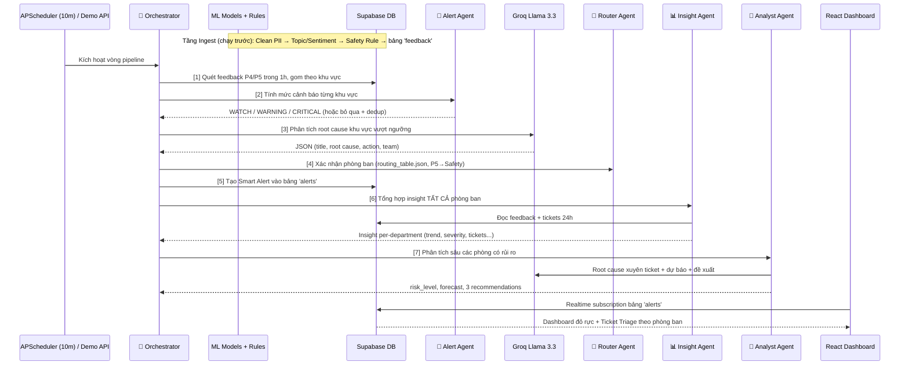

# MASTER BLUEPRINT: AI Quality Intelligence Platform (AI20K-223)
**Lĩnh vực:** Smart Mobility — Feedback Analytics | **Tech Stack:** React, FastAPI, Supabase, NLP, Multi-Agent AI (Groq Llama 3.3)

Bản tài liệu này là Thiết kế Thi công Tổng thể (Master Blueprint) — phiên bản 2.1, bao phủ **toàn bộ 3 tầng của dự án**: Backend Multi-Agent (Python/FastAPI), Frontend (React/TanStack), và Supabase (Database/Auth/Realtime). Nó tổng hợp bài toán thực tế, khoá chặt phạm vi sản phẩm, và mô tả kiến trúc **Hệ thống Multi-Agent** đã được hiện thực hóa: từ ticket được định tuyến về phòng ban → tổng hợp insight → phân tích sâu → cảnh báo thông minh, tất cả chạy **tự động khép kín** và đẩy realtime xuống Dashboard.

**Mục lục:** [1] Pain Points · [2] Kiến trúc Multi-Agent · [3] Luồng End-to-End · [4] API Surface · [5] Scope · [6] Cấu trúc Backend · [7] Kiến trúc Frontend · [8] Supabase · [9] Sprint Plan · [10] Kịch bản Demo Day

---

## 1. Phân Tích User Pain Points (Nỗi đau của người dùng)

| Chân dung User | Pain Point (Vấn đề) | Giải pháp của hệ thống (Tính năng) |
| :--- | :--- | :--- |
| **Quản lý Vận hành (Ops)** | Đọc báo cáo thủ công quá chậm, thường chỉ biết đến khủng hoảng khi nó đã bùng phát mạng xã hội. | **Orchestrator chạy tự động mỗi 10 phút:** Phát hiện spike, phân cấp cảnh báo, tạo alert realtime — không cần ai bấm nút. |
| **Đội An toàn (Safety)** | Dễ bị sót các phản hồi nghiêm trọng như "tài xế say xỉn", "tai nạn" giữa hàng ngàn review rác. | **Rule-based + Severity Override:** Keyword an toàn ép Severity P5. Router Agent ép mọi case P5 về Safety với SLA 1 giờ, kích hoạt mức 🔴 CRITICAL bất kể số lượng. |
| **Đội CSKH (CS Team)** | Nhận luồng ticket khổng lồ, không biết ưu tiên xử lý cái nào trước, mất thời gian tự tóm tắt vấn đề. | **Router Agent + Insight Agent:** AI gom phản hồi lỗi → sinh báo cáo nguyên nhân lõi → giao ticket đúng Team kèm SLA → tổng hợp insight riêng cho từng phòng. |
| **Trưởng phòng các Team** | Nhận ticket rời rạc, không có bức tranh tổng thể: phòng mình đang "nóng" đến đâu, xu hướng tăng hay giảm, nên ưu tiên gì. | **Analyst Agent (Phân tích sâu):** LLM đọc insight tổng hợp của phòng → chỉ ra nguyên nhân gốc rễ xuyên ticket, mức rủi ro, dự báo 24-48h, và 3 hành động ưu tiên kèm deadline. |
| **Đội IT / Product** | Khó theo dõi kịp thời các lỗi kỹ thuật (app lag, crash, lỗi GPS) ngay sau các đợt cập nhật app. | **Topic "App Issue" → Route về IT:** Phân loại riêng phàn nàn kỹ thuật, insight phòng IT hiển thị top khu vực lỗi để fix bug khẩn cấp. |
| **Toàn hệ thống** | Spike detector cũ spam alert trùng lặp, mọi spike đều bị gắn P1 khiến cảnh báo "nhờn". | **Alert Agent:** Phân cấp 3 mức (WATCH/WARNING/CRITICAL) + chống trùng lặp (cooldown 60 phút/khu vực). |

---

## 2. Kiến Trúc Multi-Agent (Trái tim của hệ thống)

Hệ thống gồm **5 Agent chuyên trách** đặt tại `backend/pipeline/agents/`, phối hợp qua một Orchestrator trung tâm:

| Agent | File | Nhiệm vụ |
| :--- | :--- | :--- |
| 🧭 **Router Agent** | `router_agent.py` | Định tuyến ticket về đúng phòng ban dựa trên `data_real/taxonomy/routing_table.json` (topic → team + SLA). Khớp chuẩn cấu trúc dữ liệu thật. Mức độ P5 **luôn** ép về Safety. Đổi định tuyến chỉ cần sửa JSON, không sửa code. |
| 📊 **Insight Agent** | `insight_agent.py` | Tổng hợp insight cho **từng phòng ban**: tổng feedback, tỷ lệ tiêu cực, phân bố severity, top topic/khu vực, **xu hướng % so kỳ trước**, trạng thái ticket, trích dẫn tiêu biểu. |
| 🔬 **Analyst Agent** | `analyst_agent.py` | Phân tích sâu insight bằng LLM: nguyên nhân gốc rễ **xuyên nhiều ticket**, mức rủi ro (LOW→CRITICAL), dự báo 24-48h, 3 hành động ưu tiên kèm deadline. Fallback heuristic khi không có API key. |
| 🚨 **Alert Agent** | `alert_agent.py` | Cảnh báo thông minh: phân cấp 🟡 WATCH (≥3 case) / 🟠 WARNING (≥5) / 🔴 CRITICAL (≥10 hoặc có P5) theo `severity_rules.json` + **dedup**: khu vực có alert đang xử lý trong 60 phút → không spam alert mới. |
| 🎼 **Orchestrator** | `orchestrator.py` | Điều phối vòng khép kín 7 bước (xem sơ đồ dưới), chạy tự động mỗi 10 phút qua APScheduler hoặc kích hoạt thủ công qua API. |

**Nguyên tắc thiết kế:**
- **Hybrid Fast/Slow Layer:** Dùng ML Model truyền thống để càn quét nhanh 100% dữ liệu (Fast Layer) và Multi-Agent LLM để phân tích sâu khi có cảnh báo (Slow Layer). Tối ưu chi phí API = 0 cho Ingestion.
- **Config-driven:** Định tuyến và ngưỡng cảnh báo nằm trong `data_real/taxonomy/*.json` — chạy chuẩn 100% cấu trúc nghiệp vụ thực tế của Ops.
- **Graceful degradation:** Mọi agent đều có chế độ fallback (mock/heuristic) khi thiếu `GROQ_API_KEY` — demo không bao giờ chết.
- **Tiết kiệm quota:** Analyst Agent chỉ phân tích sâu các phòng có feedback tiêu cực hoặc ticket đang mở.
- **Tương thích ngược:** Format alert giữ chuẩn `**Action Plan:** / **Assigned Team:**` nên Frontend không cần sửa.

---

## 3. Luồng Xử Lý End-to-End (Quy trình khép kín)

Hệ thống được thiết kế linh hoạt với **2 chế độ chạy**:
1. **Production:** Orchestrator tự chạy mỗi 10 phút (APScheduler) — phát hiện, phân tích, cảnh báo, tổng hợp insight hoàn toàn tự động.
2. **Demo Day:** API bắn 150 phản hồi giả lập + `POST /api/agent/run` kích hoạt vòng pipeline ngay lập tức trên sân khấu.



---

## 4. API Surface (FastAPI)

| Endpoint | Method | Mô tả |
| :--- | :--- | :--- |
| `/api/trigger-demo-batch` | POST | 🎯 Demo Day: bắn 150 review giả lập vào DB tạo Spike |
| `/api/trigger-spike-detect` | POST | Spike detection bản cũ (giữ tương thích) |
| `/api/agent/run` | POST | **Chạy ngay một vòng Multi-Agent pipeline**, trả về báo cáo đầy đủ |
| `/api/agent/last-run` | GET | Báo cáo lượt chạy pipeline gần nhất |
| `/api/insights/departments?hours=24` | GET | Insight tổng hợp của **tất cả** phòng ban |
| `/api/insights/departments/{team}` | GET | Insight của một phòng (Safety, IT, CSKH, Vận Hành...) |
| `/api/insights/departments/{team}/deep-analysis` | GET | **Phân tích sâu bằng LLM** cho một phòng ban |

---

## 5. Phạm Vi Sản Phẩm (Scope)

**✅ NHỮNG GÌ CHẮC CHẮN LÀM (IN SCOPE):**
1. **Kiến trúc Cloud:** Triển khai 100% online (Vercel cho Frontend, Railway/Render cho Backend, Supabase cho Database).
2. **Auth & Roles:** Đăng nhập, đăng ký an toàn.
3. **Data Pipeline Dual-Mode:** APScheduler tự động (5-10 phút) và Endpoint phục vụ Demo 150 reviews.
4. **NLP Processing:** 2 model `.joblib` gán nhãn Topic/Sentiment kết hợp Rule-based Safety (keyword → P5).
5. **Hệ thống Multi-Agent (5 agents):** Router → Insight → Analyst → Alert → Orchestrator, chạy tự động khép kín mỗi 10 phút.
6. **Cảnh báo phân cấp + chống trùng:** WATCH/WARNING/CRITICAL theo `severity_rules.json`, cooldown 60 phút.
7. **Insight & Deep Analysis per-department:** API trả về số liệu tổng hợp + phân tích LLM cho từng phòng ban.
8. **Config-driven Routing:** `routing_table.json` + `severity_rules.json` trong `data_real/taxonomy/` — tích hợp hoàn chỉnh với dataset thật của tổ chức.
9. **Frontend 3 Màn hình:** `Dashboard` (Trend, Heatmap), `Alerts/Ticket Triage` (lọc theo phòng ban, realtime), `Feedback List` (sửa nhãn — Human-in-the-loop), và thêm màn `Department Insights` dùng Promise.all loại bỏ waterfall loading.

**❌ NHỮNG GÌ KHÔNG LÀM (OUT OF SCOPE):**
1. Không code hệ thống streaming data phức tạp (như Kafka). Dùng kiến trúc Batch qua Scheduler.
2. Không train lại mô hình NLP từ số 0. Tái sử dụng `.joblib` có sẵn.
3. Chưa tích hợp App thật của tài xế.
4. Chưa gửi notification ra kênh ngoài (Slack/Email) — alert hiển thị qua Dashboard realtime.

---

## 6. Cấu Trúc Backend (Đã hiện thực)

```
backend/pipeline/
├── main.py                  # FastAPI + APScheduler (agent pipeline mỗi 10 phút)
├── clean.py                 # Làm sạch text, giấu PII (SĐT, Email)
├── classifier.py            # ML Topic/Sentiment + Rule-based Safety Override
├── ingest.py                # Ghi feedback đã gán nhãn vào Supabase
├── spike_detector.py        # Spike detection bản cũ (giữ tương thích)
├── llm_agent.py             # Gọi Groq Llama 3.3 phân tích root cause (có mock)
└── agents/                  # 🤖 HỆ THỐNG MULTI-AGENT
    ├── common.py            # Supabase client (lazy) + LLM helper dùng chung
    ├── router_agent.py      # Định tuyến ticket theo routing_table.json
    ├── insight_agent.py     # Tổng hợp insight per-department
    ├── analyst_agent.py     # Phân tích sâu LLM (fallback heuristic)
    ├── alert_agent.py       # Cảnh báo phân cấp + dedup
    └── orchestrator.py      # Vòng pipeline khép kín 7 bước

data/taxonomy/
├── routing_table.json       # Topic → Phòng ban + SLA (P5 override → Safety)
├── severity_rules.json      # Ngưỡng WATCH/WARNING/CRITICAL + cooldown
├── taxonomy.json            # Cây phân loại chủ đề
└── safety_keywords.json     # Từ khóa Rule-based Safety
```

---

## 7. Kiến Trúc Frontend (React — Quality Operation Cockpit)

### 7.1. Tech Stack

| Thành phần | Công nghệ | Ghi chú |
| :--- | :--- | :--- |
| Framework | **React 19 + TypeScript** | Build bằng Vite |
| Routing | **TanStack Router + TanStack Start** | File-based routing, có Server Functions (SSR-capable) |
| UI Kit | **TailwindCSS 4 + shadcn/ui (Radix)** | ~50 component dựng sẵn trong `components/ui/` |
| Biểu đồ | **Recharts** | Line/Bar chart cho Dashboard |
| Data & Auth | **@supabase/supabase-js** | Client browser + client server riêng biệt |
| Thông báo | **sonner** (toast) + **lucide-react** (icons) | |

### 7.2. Cấu trúc Routes & Màn hình

```
UI/src/routes/
├── index.tsx                    # Landing page
├── auth.tsx                     # Đăng nhập / Đăng ký (Supabase Auth)
└── _authenticated/              # 🔒 Layout có Auth Guard
    ├── route.tsx                #    beforeLoad: chưa đăng nhập → redirect /auth
    ├── dashboard.tsx            ### 3.1 Giao Diện (Frontend - React/Vite)
- **Dashboard / Quality Cockpit:** Tổng hợp biểu đồ, danh sách ticket mới.
- **Feedback Collection (T-C-R):**
  - **Auto-Tagging (AI-in-the-middle):** Form phản hồi cho khách hàng chỉ chứa Text và Area. Khách hàng không cần tự đánh giá nhãn. Khi gửi, giao diện sẽ đẩy Text về Backend API để AI tự động phân tích (Topic, Sentiment, Severity) trước khi lưu.
  - Chức năng sửa nhãn thủ công (Control) cho Admin và Hoàn tác (Recovery).
- **Department Insights:** Báo cáo root cause do LLM Analyst viết cho riêng từng phòng ban.
    ├── feedback.tsx             # 📝 Danh sách phản hồi + sửa nhãn (Human-in-the-loop)
    └── chat.tsx                 # 💬 AI Assistant (Groq Llama 3.3)
```

**Auth Guard** (`_authenticated/route.tsx`): mọi trang con đều chạy `supabase.auth.getUser()` trong `beforeLoad` — không có session hợp lệ thì redirect về `/auth`. Layout bọc chung bằng `AppShell` (sidebar điều hướng).

### 7.3. Chi tiết 4 màn hình chính

| Màn hình | Thành phần chính | Nguồn dữ liệu |
| :--- | :--- | :--- |
| **Dashboard** (`QualityCockpit.tsx`) | KPI Strip, Trend Chart, Category Breakdown, **Live Feed (realtime)**, Alerts Panel, **Heatmap khu vực × giờ** | Bảng `feedback` + `alerts`, subscribe realtime channel `dashboard-live-feedback` |
| **Alerts / Ticket Triage** (`alerts.tsx`) | Tab lọc theo phòng ban (Tất cả/Vận Hành/CSKH/Safety/IT/Driver Mgmt), thẻ alert có icon + màu riêng từng team, nút chuyển trạng thái `open → in_progress → resolved` | Bảng `alerts`, realtime subscription — alert mới từ Agent **tự hiện không cần F5**. Parse `assigned_team` từ format `**Assigned Team:**` trong description |
| **Feedback** (`feedback.tsx`) | Danh sách 100 phản hồi mới nhất + form nhập tay + **sửa nhãn AI sai** (topic/sentiment/severity) → update thẳng Supabase | Bảng `feedback` — đây là vòng lặp **Human-in-the-loop** |
| **Chat AI** (`chat.tsx` + `ai.functions.ts`) | Chat với AI Assistant chuyên về quality ops, có câu hỏi gợi ý sẵn, lưu lịch sử | **Server Function** (TanStack Start) gọi Groq API phía server — API key không bao giờ lộ ra browser. Lịch sử lưu bảng `chat_messages` |

### 7.4. Hai đường dữ liệu của Frontend

```
┌──────────────────────────────────────────────────────────────┐
│  Đường 1 — TRỰC TIẾP (đọc/ghi dữ liệu):                      │
│  React ──@supabase/supabase-js──▶ Supabase (anon key + RLS)  │
│  Dùng cho: dashboard, alerts, feedback, lịch sử chat          │
│  + Realtime subscription: alert/feedback mới tự đẩy về UI    │
│                                                                │
│  Đường 2 — QUA SERVER (việc cần bí mật API key):             │
│  React ──Server Function──▶ Groq API (chat AI)               │
│  React ──HTTP──▶ FastAPI Backend (trigger demo, agent run)   │
└──────────────────────────────────────────────────────────────┘
```

> 💡 **Điểm hay của kiến trúc này:** Backend Python ghi alert vào Supabase → Supabase Realtime đẩy thẳng xuống browser. Frontend và Backend **không cần gọi API trực tiếp cho nhau** trong luồng chính — Supabase là "trạm trung chuyển" realtime.

---

## 8. Supabase — Database, Auth & Realtime

### 8.1. Sơ đồ 4 bảng (PostgreSQL)

```
auth.users (Supabase Auth quản lý)
    │ 1-1 (trigger tự tạo khi signup)
    ▼
profiles ◀────────────┐
  id (PK→auth.users)  │ user_id (FK)
  email, full_name    │
                      │
feedback ─────────────┤      alerts ──────────────┐    chat_messages
  id uuid PK          │        id uuid PK          │      id uuid PK
  user_id FK ─────────┘        user_id FK ─────────┘      user_id FK
  source, channel              title                      role (user/assistant/system)
  text (đã mask PII)           description (chứa Action   content
  topic, sentiment              Plan + Assigned Team +    created_at
  severity (P1→P5)              Escalation Level)
  area, confidence             severity (P1/P2/P3)
  created_at                   area, status (open→in_progress→resolved)
                               created_at
```

| Bảng | Ai ghi | Ai đọc | Realtime |
| :--- | :--- | :--- | :--- |
| `profiles` | Trigger `handle_new_user` (tự động khi signup) | Frontend | — |
| `feedback` | **Backend** (`ingest.py`) + Frontend (form nhập tay, sửa nhãn) | Dashboard, Feedback page | ✅ (publication `supabase_realtime`) |
| `alerts` | **Backend** (Alert Agent / spike_detector) + Frontend (đổi status) | Ticket Triage, Dashboard | ✅ |
| `chat_messages` | Frontend (sau mỗi lượt chat) | Chat page | — |

### 8.2. Bảo mật — Row Level Security (RLS) & 2 loại key

Tất cả 4 bảng đều bật **RLS** với policy `auth.uid() = user_id` — user chỉ thấy/sửa dữ liệu của chính mình.

| Key | Ai dùng | Quyền |
| :--- | :--- | :--- |
| **Anon Key** (`VITE_SUPABASE_URL` + anon) | Frontend (browser) | Bị RLS ràng buộc — chỉ thao tác dữ liệu của user đang đăng nhập |
| **Service Role Key** (`SUPABASE_SERVICE_ROLE_KEY`) | Backend Python (server-only) | **Bypass RLS** — ghi feedback/alerts hàng loạt. Tuyệt đối không để lộ ra browser/Git |

> ⚠️ Vì bảng `feedback`/`alerts` yêu cầu `user_id NOT NULL`, backend lấy 1 user bất kỳ trong `profiles` làm "user hệ thống" khi insert. Đây là lý do **phải đăng ký ít nhất 1 tài khoản trên Frontend trước khi chạy demo batch**.

### 8.3. Auth Flow & Trigger tự động

1. User đăng ký qua `/auth` → Supabase Auth tạo record trong `auth.users`.
2. Trigger `on_auth_user_created` → function `handle_new_user()` (SECURITY DEFINER) tự insert vào `profiles` (lấy `full_name` từ metadata, fallback từ email).
3. Mọi request sau đó mang JWT của user → RLS tự lọc dữ liệu.

### 8.4. Realtime — Trái tim của trải nghiệm "Dashboard tự đỏ"

```sql
-- Migration: enable_feedback_realtime.sql
ALTER PUBLICATION supabase_realtime ADD TABLE public.feedback;
```

- Dashboard subscribe channel `dashboard-live-feedback` trên bảng `feedback` → demo bắn 150 review là Live Feed nhảy số ngay.
- Trang Alerts subscribe `postgres_changes` trên bảng `alerts` → Alert Agent tạo ticket là thẻ cảnh báo **tự xuất hiện trên màn chiếu**, không ai phải bấm refresh.

### 8.5. Migrations & Biến môi trường

Schema quản lý bằng SQL migrations tại `UI/supabase/migrations/` (3 file: tạo bảng + RLS, policies bổ sung, bật realtime). Áp dụng bằng Supabase CLI hoặc dán vào SQL Editor trên dashboard Supabase.

| Biến | Frontend (UI/.env) | Backend (.env gốc hoặc backend/.env) |
| :--- | :---: | :---: |
| `VITE_SUPABASE_URL` | ✅ | ✅ |
| Anon key (public) | ✅ | — |
| `SUPABASE_SERVICE_ROLE_KEY` | ❌ KHÔNG BAO GIỜ | ✅ |
| `GROQ_API_KEY` | ✅ (chỉ server function đọc qua `process.env`) | ✅ |
| `GROQ_MODEL_NAME` | ✅ | ✅ |

---

## 9. Kế Hoạch Lập Trình Chi Tiết (Sprint Plan)

### Tuần 1: Cấu trúc hạ tầng & Đưa dự án lên Cloud ✅
*Mục tiêu: Đập tan rủi ro Deployment. Web phải truy cập được trên internet bằng URL thật.*
- Áp dụng file `.sql` lên Supabase Cloud tạo 4 bảng (`feedback`, `alerts`, `profiles`, `chat_messages`).
- Kết nối `supabase.ts` → Deploy **Vercel**. Kiểm tra luồng Auth.
- Tạo API gốc **FastAPI** (`main.py`) → Deploy **Railway/Render**.

### Tuần 2: Xây dựng Não trái (Data Pipeline & NLP) ✅
*Mục tiêu: Dữ liệu thô đi vào → Dữ liệu sạch có nhãn AI đi ra.*
- `pipeline/clean.py`: Regex giấu PII (SĐT, Email).
- `pipeline/classifier.py`: Load `.joblib` models + Rule-based (keyword "tai nạn" → severity P5).
- `pipeline/ingest.py`: Luồng Production (APScheduler) và Demo (API trigger 150 JSON) → Supabase.

### Tuần 3: Xây dựng Não phải (Multi-Agent System) ✅
*Mục tiêu: Hệ thống tự phát hiện "biến", tự phân luồng, tự tổng hợp insight và phân tích sâu.*
- `agents/router_agent.py`: Định tuyến config-driven từ `routing_table.json`, P5 ép về Safety SLA 1h.
- `agents/alert_agent.py`: Phân cấp WATCH/WARNING/CRITICAL + dedup cooldown — thay thế cơ chế "mọi spike đều P1".
- `agents/insight_agent.py`: Gom feedback + tickets 24h theo phòng ban, tính trend % so kỳ trước.
- `agents/analyst_agent.py`: Prompt LLM phân tích xuyên ticket → risk level, forecast, 3 recommendations.
- `agents/orchestrator.py`: Nối 7 bước thành vòng khép kín, cắm vào APScheduler (10 phút/lần).
- `main.py`: Mở 5 API mới (`/api/agent/*`, `/api/insights/*`).

### Tuần 4: Đánh bóng Front-end & Luyện Kịch Bản Demo
*Mục tiêu: Giao diện trực quan, chuyên nghiệp, vượt qua vòng nghiệm thu.*
- `Dashboard`: Biểu đồ Recharts (Line Chart, Bar Chart) + Heatmap khu vực.
- `Alerts/Ticket Triage`: Thẻ cảnh báo phân cấp màu (🟡🟠🔴), lọc theo tab phòng ban, realtime subscription.
- `Feedback`: Nút **[Edit Label]** sửa nhãn AI sai → Update Supabase (Human-in-the-loop).
- *(Gợi ý mở rộng)* Trang **Department Insights**: gọi `/api/insights/departments` vẽ bảng điều khiển riêng cho từng trưởng phòng.

---

## 10. Kịch Bản Demo Day (5 phút)

1. **Bật server** → APScheduler tự chạy nền.
2. **Bắn dữ liệu:** `POST /api/trigger-demo-batch` → 150 reviews đổ vào DB, dồn về `HN-Cau-Giay`.
3. **Kích hoạt Agent:** `POST /api/agent/run` → Orchestrator quét, Alert Agent phân cấp 🔴 CRITICAL, LLM sinh root cause, Router giao về đúng phòng.
4. **Dashboard đỏ rực** → Ticket Triage hiện alert theo từng phòng ban (realtime, không cần F5).
5. **Show Insight:** Mở `/api/insights/departments/Safety/deep-analysis` → AI chỉ ra nguyên nhân gốc rễ, dự báo 48h, 3 hành động kèm deadline.
6. **Human-in-the-loop:** Sửa 1 nhãn AI nhận diện nhầm trên trang Phản hồi.
7. **Chốt hạ:** Bắn thêm 1 đợt dữ liệu cùng khu vực → hệ thống **không spam alert trùng** (dedup hoạt động) — chứng minh đây là hệ thống production-ready, không phải demo "đốt pháo".
