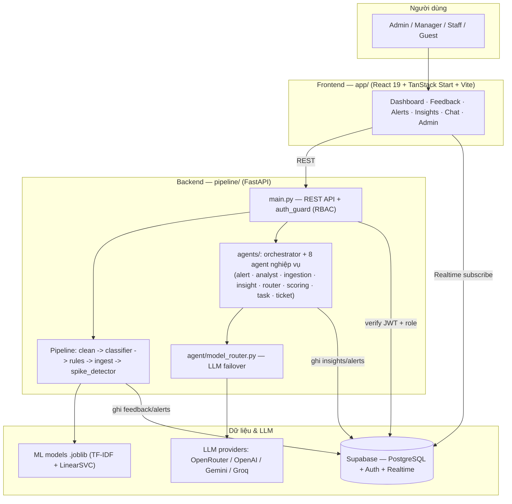
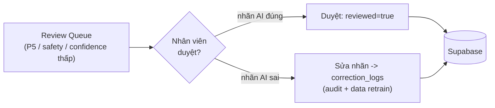
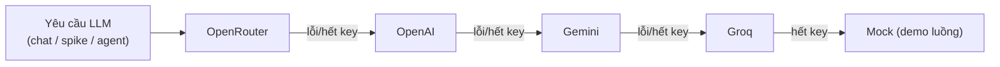
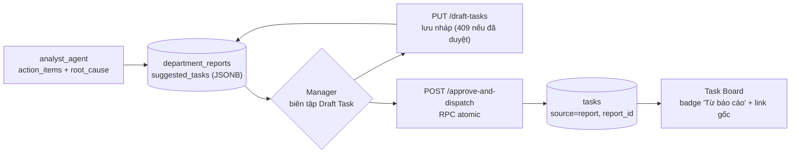

# Architecture Diagram — AI Quality Intelligence Platform

> **Cập nhật 2026-06-27:** Cập nhật nhãn multi-agent trong component diagram (8 agent nghiệp vụ + Orchestrator, thay tên rút gọn cũ).

Sơ đồ components + data flow cho Gate G2. GitHub render trực tiếp các khối Mermaid bên dưới.
Bản mô tả chữ chi tiết: [`docs/project/architecture.md`](architecture.md).

## 1. Component diagram (tổng quan hệ thống)

## 2. Data flow — user flow chính (review → phân loại → spike → alert)

```mermaid
flowchart LR
    R["Review thô<br/>(form / streaming 50/s / dataset)"]
    C1["clean.py<br/>mask PII + chuẩn hoá"]
    C2["classifier.py<br/>TF-IDF + LinearSVC"]
    C3["rules.py<br/>rule keyword + Safety override + confidence band"]
    I["ingest.py<br/>ghi Supabase feedback"]
    S["spike_detector.py<br/>group theo khu vực, đếm P4/P5"]
    L["llm_agent.py<br/>LLM phân tích root cause + định tuyến phòng ban"]
    A["alerts<br/>ghi Supabase -> FE realtime"]

    R --> C1 --> C2 --> C3 --> I --> S --> L --> A
```

## 3. Human-in-the-Loop (vòng học khép kín)

## 4. LLM provider failover

## 5. HI-Loop Approval (báo cáo → task khép kín)

