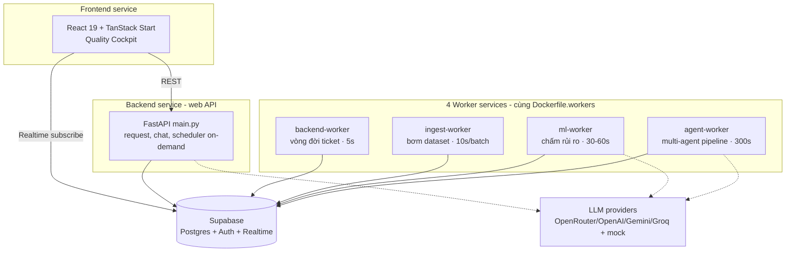
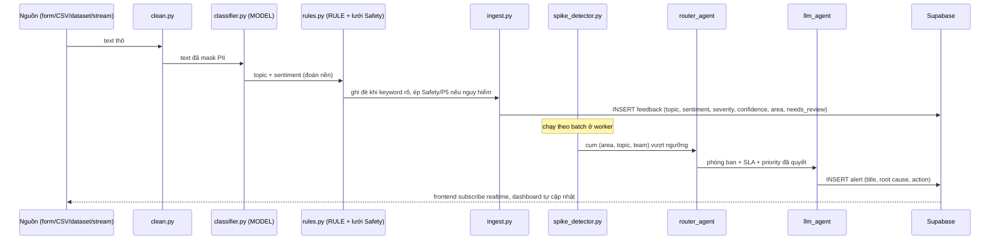
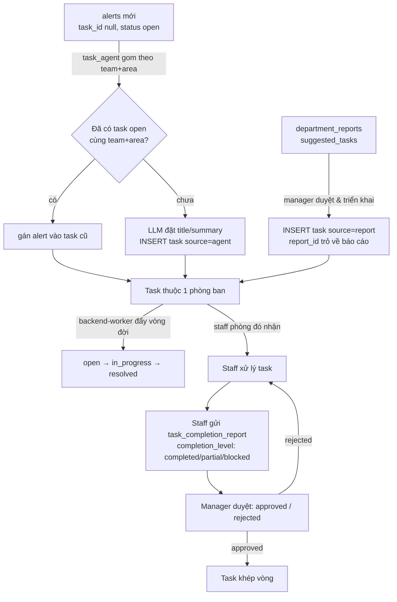
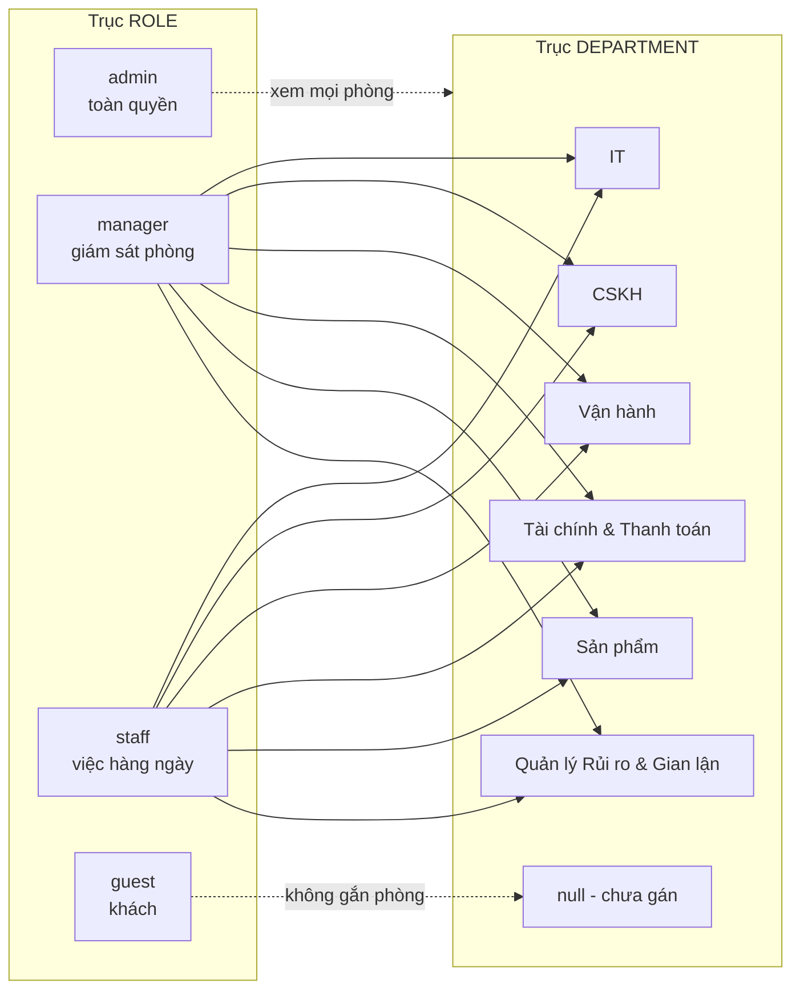
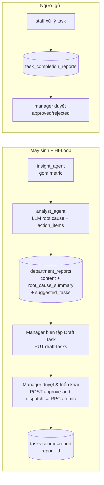

# Cơ chế hoạt động hệ thống — AI Quality Intelligence Platform (xanhSM)

Tài liệu này có hai mục đích trong một file:

1. **Phần A — Cơ chế đúng**: mô tả hệ thống vận hành chuẩn từ lúc một review đi vào cho tới khi phòng ban xử lý xong và sinh báo cáo. Đủ chi tiết để dựng lại đúng (luồng, bảng dữ liệu, quyền, phòng ban, cách chia việc top-down).
2. **Phần B — Lộ trình cải thiện**: chỉ ra chỗ chưa hoàn chỉnh và cách nâng thành một hệ thống production hoàn chỉnh, viết theo dạng spec để một agent đọc rồi tự cải tiến.

Tài liệu liên quan: `docs/project/giai_thich.md` (giải thích as-is theo góc người dùng), `docs/project/architecture.md`, `docs/project/agents-guide.md`, `docs/project/rbac-departments.md`.

Quy ước đọc: mỗi mục có phần "Đúng phải thế nào" để dùng làm tiêu chí khi build lại hoặc kiểm thử.

---

# PHẦN A — CƠ CHẾ ĐÚNG

## 1. Bài toán và triết lý thiết kế

Mỗi ngày có hàng nghìn phản hồi khách hàng về dịch vụ gọi xe. Con người không đọc xuể. Hệ thống đọc thay, gán nhãn, phát hiện cụm vấn đề bất thường, sinh cảnh báo và ticket theo SLA, giao đúng phòng ban để xử lý trước khi sự cố lan rộng, rồi tổng hợp thành báo cáo.

Bốn nguyên tắc chi phối toàn bộ thiết kế. Nắm bốn cái này thì mọi quyết định kỹ thuật bên dưới đều suy ra được.

| Nguyên tắc | Nghĩa là gì | Hệ quả trong code |
|-----------|-------------|-------------------|
| Hybrid fast/slow | ML rẻ chạy trên toàn bộ data, LLM đắt chỉ chạy ở chỗ cần suy luận | ML classify mọi review (cost 0), LLM chỉ dùng cho root cause, spike, đặt tên task |
| Safety-first | An toàn không nhường cho xác suất | Lưới Safety (rule) luôn ghi đè model, ép P5 và cần duyệt |
| Config-driven | Đổi hành vi nghiệp vụ không cần sửa code | Routing và ngưỡng nằm trong `data/taxonomy/*.json` |
| Graceful degradation | Hỏng một mảnh không sập cả hệ | Mọi agent có fallback khi LLM lỗi hoặc thiếu key, hết key thật thì mock |

## 2. Bản đồ kiến trúc

Một repo, ba tầng. Supabase là trục nối: pipeline Python ghi kết quả, frontend đọc ra để hiển thị realtime.

```
C2-App-116/
├── app/        Frontend TanStack Start + React 19 (Cockpit, auth, chat, admin)
├── pipeline/   Python FastAPI: clean → classify → ingest → spike → LLM → multi-agent
├── supabase/   PostgreSQL + RBAC + RLS (migration)
└── data/       Dataset review + knowledge base + taxonomy + reference
```

Production deploy thành sáu Railway service Docker. Web API và bốn worker dùng chung source `pipeline/`, tách tiến trình để mỗi việc chạy theo nhịp riêng và không giẫm chân nhau.



Nhịp và chi phí từng service:

| Service | Việc chính | Nhịp | Gọi LLM |
|---------|-----------|------|---------|
| `backend` (web API) | Nhận request, chat, scheduler theo lệnh admin | theo request | có (chat) |
| `ingest-worker` | Bơm dataset theo batch, tự spike detect | 10s/batch | gián tiếp |
| `ml-worker` | Quét feedback tiêu cực chưa chấm rủi ro, chấm 5 chiều | 30-60s | có |
| `agent-worker` | Chạy full multi-agent pipeline | 300s | có |
| `backend-worker` | Đẩy vòng đời ticket open → in_progress → resolved | 5s | không (rule) |

Chỉ `ml-worker` và `agent-worker` tốn tiền LLM. Cả hai có cờ tắt (`WORKER_AGENT_ENABLED=false`) hoặc fallback mock, nên có thể chạy demo không tốn quota.

**Đúng phải thế nào**: web API không tự chạy job định kỳ trừ khi admin bấm. Mọi job nền nằm ở worker. Nếu thấy web API tự bơm dataset hay tự chạy agent loop, đó là sai tách trách nhiệm.

## 3. Luồng xương sống: một review từ đầu đến cuối

Lấy ví dụ câu phản hồi: *"Tài xế đi ẩu, suýt tông người, thái độ còn khó chịu."* Đây là đường đi của nó qua bảy chặng.



Chi tiết từng chặng và "đúng phải thế nào":

**[1] clean.py — che PII và chuẩn hóa.** Mask số điện thoại, email, biển số xe. Đầu vào lẫn đầu ra của mọi lời gọi LLM về sau đều phải đi qua mask này. Đúng phải thế nào: không có PII thô nào lọt vào bảng `feedback` hay vào prompt LLM.

**[2] classifier.py — model TF-IDF + LinearSVC.** Đoán topic (7 lớp) và sentiment. Đây là tầng đoán nền, rẻ, chạy trên toàn bộ data. Độ chính xác trên test 932 mẫu: topic 77.1%, sentiment 94.3%. Model yếu ở câu ngắn (ít token, hay ngả về lớp tiêu cực đa số), nên cần tầng rule bù vào.

**[3] rules.py — rule keyword và lưới Safety.** Chạy SAU model, ghi đè khi tín hiệu rõ. Thứ tự ưu tiên: Safety > Driver-positive > Payment-fraud > App > Map > Payment > Supply > Driver-negative > Pricing > Delay > Positive chung. Có negation guard (từ phủ định ngay trước keyword chặn gán sai, ví dụ "app không thân thiện" không phải positive) và confidence band thật (rule mạnh 80-88%, mơ hồ 50-65%, câu ngắn ≤50%). Lưới Safety: review chứa keyword nguy hiểm (tai nạn, xe tông, bỏ chạy, say xỉn, cướp, hành hung, sàm sỡ) bị ép `Safety / negative / P5 / needs_review=true`. Đúng phải thế nào: rule luôn thắng model. Câu ví dụ ở trên rơi vào lưới Safety, thành P5, cần duyệt.

**[4] ingest.py — ghi bảng feedback.** Ghi topic, sentiment, severity (P1 đến P5), confidence, area code, needs_review, review_reason. `needs_review=true` khi P5, hoặc safety, hoặc confidence thấp. Đúng phải thế nào: area lưu dạng code (`HN-Cau-Giay`) để khớp spike detector, UI tự map sang label đẹp.

**[5] spike_detector.py — phát hiện cụm bất thường.** Gom feedback theo `(area, topic, team)`, áp ngưỡng risk và volume. Vượt ngưỡng thì thành spike. Đây là nơi quyết định "có đáng tạo cảnh báo không", lọc nhiễu trước khi tốn LLM.

**[6] router_agent + llm_agent — định tuyến và viết nội dung.** Router quyết định phòng ban, SLA, priority theo bảng routing (mục 4). LLM chỉ viết title, mô tả nguyên nhân gốc, hành động đề xuất. Đúng phải thế nào: LLM không được tự gán phòng ban. Việc gán phòng là của router (rule, đọc JSON), để kiểm soát và audit được.

**[7] alerts — ghi ticket.** Ghi vào bảng `alerts` với `assigned_team`, `topic`, `priority`, `ticket_type`, `routing_source`, `sla_due_at`. Frontend subscribe realtime nên dashboard cập nhật ngay.

## 4. Cơ chế sinh ticket và alert

Một spike trở thành alert qua hai quyết định tách biệt: phân cấp mức độ (alert_agent) và định tuyến phòng ban (router_agent).

### Phân cấp mức độ — alert_agent

Đọc ngưỡng từ `data/taxonomy/severity_rules.json`. Fallback nếu thiếu file: WATCH ≥3, WARNING ≥5, CRITICAL ≥10 case, cooldown 60 phút.

```
classify_alert_severity(case_count, has_p5):
    nếu has_p5            → CRITICAL          (P5 luôn là CRITICAL)
    nếu case_count ≥ 10   → CRITICAL
    nếu case_count ≥ 5    → WARNING
    nếu case_count ≥ 3    → WATCH
    còn lại              → INFO (không tạo alert)
```

Chống trùng: `is_duplicate_alert` đọc bảng `alerts` tìm alert cùng area, status=open, còn trong cooldown. Có thì bỏ qua, không tạo mới. Đúng phải thế nào: scheduler chạy lại nhiều lần không được sinh alert trùng. Tính idempotent là bắt buộc.

### Định tuyến phòng ban — router_agent

`route_ticket(topic, severity, sentiment)` đọc `data/taxonomy/routing_table.json`. Thứ tự ưu tiên, cái trên thắng cái dưới:

1. `severity_overrides`: P5 → Vận hành (thắng mọi thứ).
2. `sentiment_overrides`: positive chung hoặc góp ý tính năng (Other, App Issue) → Sản phẩm.
3. `routes`: match theo topic.
4. `default_team`: CSKH.

Bảng routing thật:

| Topic | Phòng ban | SLA | Priority |
|-------|-----------|----:|----------|
| Safety | Vận hành | 1h | P5 |
| Driver Behavior | Vận hành | 8h | P3 |
| App Issue | IT | 12h | P3 |
| Payment | Tài chính & Thanh toán | 12h | P3 |
| Pricing | Quản lý Rủi ro & Gian lận | 12h | P3 |
| Delay | Vận hành | 8h | P3 |
| Other | CSKH | 24h | P4 |

Hai luật ghi đè quan trọng: mọi ticket P5 ép về Vận hành (đội phản ứng nhanh) bất kể topic; phản hồi tích cực chung hoặc góp ý tính năng (positive + Other/App Issue) chuyển Sản phẩm để khai thác nâng cấp UX/UI, còn positive gắn chủ đề chuyên môn khác (Payment, Driver Behavior, Pricing...) vẫn về đúng phòng theo topic.

Đúng phải thế nào: đổi routing chỉ sửa JSON, không sửa code. Nếu phải sửa code để đổi một tuyến, thiết kế đã sai chỗ config-driven.

## 5. Cơ chế chia việc từ trên xuống

Đây là phần hay bị hiểu sai. Có ba lớp dữ liệu khác nhau, đừng lẫn:

- **alert** (bảng `alerts`): một sự cố hoặc cụm vấn đề, đã định tuyến phòng ban và SLA.
- **task** (bảng `tasks`): một đầu việc để phòng nhận và xử lý. Mỗi task có cột `source` cho biết nguồn gốc: `agent` (máy gom nhiều alert cùng `(phòng, khu vực)`) hoặc `report` (manager duyệt báo cáo rồi triển khai). Task từ báo cáo còn có `report_id` trỏ ngược về `department_reports` để nhân viên biết ngữ cảnh.
- **task_completion_report** (bảng `task_completion_reports`): nhân viên báo cáo đã xử lý task tới đâu, quản lý duyệt.

Task sinh ra theo **hai đường**, cùng đổ về bảng `tasks` và cùng hiển thị trên Task Board:

1. **Tự động từ alert (`source=agent`)** — `task_agent` gom các alert chưa có task theo `(phòng, khu vực)`. Không cần con người.
2. **Manager duyệt báo cáo (`source=report`)** — luồng HI-Loop Approval: AI đề xuất danh sách hành động trong báo cáo, manager chỉnh sửa rồi bấm một nút để biến chúng thành task chính thức (xem mục 8).

Việc chảy từ trên xuống theo sơ đồ sau. Hệ thống sinh việc tự động, admin và manager nhìn toàn cảnh, việc rớt xuống đúng phòng, staff xử lý và báo cáo ngược lên.



Cơ chế gom task (`task_agent.cluster_alerts_into_tasks`): đọc `alerts` có `task_id` null và `status=open`, gom theo `(assigned_team, area)`. Mỗi cụm tìm task open cùng team và area, chưa có thì gọi LLM sinh title và summary rồi INSERT (`source=agent`). Đúng phải thế nào: một cụm `(team, area)` chỉ có một task open tại một thời điểm, để tránh phòng nhận trùng việc.

Vòng đời ticket (`backend-worker`, mỗi 5 giây): đẩy `open → in_progress → resolved` theo rule, không tốn LLM. SLA quá hạn được `ticket_agent.get_overdue_tickets(sla_hours=24)` quét ra.

Phân quyền top-down trong việc chia việc:

- **admin và manager** nhìn toàn cảnh (admin toàn hệ thống, manager phòng mình), thấy task rơi vào phòng, theo dõi tiến độ và SLA. Manager cũng là người duyệt báo cáo để triển khai task `source=report`.
- **staff** chỉ thấy task phòng mình, nhận và xử lý, gửi báo cáo hoàn thành.
- Hệ thống (task_agent) sinh task tự động từ alert. Ngoài ra task còn đến từ manager duyệt báo cáo. Staff không tạo task thủ công, chỉ xử lý và duyệt.

## 6. Phòng ban

Sáu phòng ban hợp lệ hiện tại: **IT, CSKH, Vận hành, Tài chính & Thanh toán, Sản phẩm, Quản lý Rủi ro & Gian lận**. Trước đây có Safety và Pricing đã bỏ làm phòng ban (migration `20260625`), và Marketing đã bỏ (migration `20260630`, reassign user + dữ liệu lịch sử về Sản phẩm). Các topic vẫn được định tuyến: topic Safety về Vận hành, topic Pricing về Quản lý Rủi ro & Gian lận, topic Payment về Tài chính & Thanh toán. Lưu ý phân biệt: Safety và Pricing vẫn tồn tại như *topic* định tuyến, nhưng không còn là *phòng ban* để gán user.

Định nghĩa phòng ban nằm ở ba chỗ phải khớp nhau: `DEPARTMENTS` (`departments.py`), `DEPARTMENT_PERSONAS` (`analyst_agent.py`), `valid_departments` (`users_admin.py`). Một ops user có thể chưa được gán phòng (`department = null`), khi đó chưa xem được dữ liệu phòng nào cho tới khi admin gán.

Mỗi phòng có persona riêng cho analyst_agent (giọng phân tích, ưu tiên, action fallback) hardcode trong `DEPARTMENT_PERSONAS`. RAG nội bộ lọc tài liệu theo `department` trong YAML frontmatter của file knowledge base. Phòng không có tài liệu thì RAG trả rỗng, không fallback sang phòng khác. Đúng phải thế nào: không rò rỉ tài liệu chéo phòng qua RAG.

## 7. Tài khoản và phân quyền

Hai trục phân quyền tách biệt: **role** (cấp độ quyền) và **department** (phòng ban, quyết định thấy dữ liệu của ai).



Bốn role:

| Role | Nhãn UI | Quyền |
|------|---------|-------|
| `admin` | Quản trị viên | Toàn quyền: quản lý user, bật/tắt streaming, trigger pipeline, xem mọi phòng |
| `manager` | Quản lý | Giám sát phòng mình: alerts, tasks, insights, reports, duyệt báo cáo, chat |
| `staff` | Nhân viên | Việc hàng ngày phòng mình: feedback, tasks, gửi báo cáo hoàn thành, chat |
| `guest` | Khách | Dashboard rút gọn, gửi feedback, chat hỗ trợ CSKH |

`OPS_ROLES = {admin, manager, staff}` là nhóm nhân sự vận hành, phân biệt với guest.

### Cách hệ thống chặn xem chéo phòng

Backend chạy bằng `SUPABASE_SERVICE_ROLE_KEY` nên bypass RLS của Postgres. Vì vậy mọi kiểm tra quyền nằm ở tầng API trong `pipeline/auth_guard.py`. RLS trong migration chỉ là lớp phòng thủ dự phòng, không phải nơi quyết định quyền.

`get_current_user` lấy Bearer token, gọi `db.auth.get_user(token)` để Supabase verify JWT, rồi đọc `role` và `department` từ bảng `profiles`. Ba dependency gate:

- `get_current_user`: mọi user đã đăng nhập (gồm guest).
- `require_ops_staff`: chỉ OPS_ROLES, chặn guest (403).
- `require_admin`: chỉ admin (403 nếu khác).

Hai helper scope phòng ban, đây là trái tim của RBAC:

- `scoped_team(user, requested_team)`: dùng cho endpoint **list**, ép phạm vi truy vấn. Admin tôn trọng `requested_team` (None nghĩa là xem tất cả). Ops chưa gán phòng raise 403. Ops đã gán phòng luôn ép về `user.department`, bỏ qua `requested_team`.
- `can_view_team(user, team)`: dùng cho thao tác trên **một record**, chặn ghi/đọc chéo phòng. Admin luôn True. Ops chưa gán phòng False. Ops đã gán True nếu `user.department == team`.

### Ma trận quyền theo endpoint

Endpoint dùng `scoped_team` (ép phạm vi list):

| Endpoint | Lọc theo | admin | manager/staff |
|----------|----------|-------|---------------|
| `GET /api/tasks` | `assigned_team` | mọi phòng | phòng mình |
| `GET /api/reports` | `team` | mọi phòng | phòng mình |
| `GET /api/agent/ai-log` | team | tôn trọng `?team` | phòng mình |
| `GET /api/insights/departments` | team | mọi phòng | chỉ phòng được phép |

Endpoint dùng `can_view_team` (chặn thao tác chéo phòng):

| Endpoint | Kiểm tra team của |
|----------|-------------------|
| `PATCH /api/tasks/{id}/status` | task |
| `PATCH /api/tasks/{id}/assign` | task |
| `PATCH /api/alerts/{id}/status` | task_id → assigned_team |
| `PATCH /api/reports/{id}/approve` | report |
| `PUT /api/reports/{id}/draft-tasks` | report (lưu nháp danh sách hành động, 409 nếu đã duyệt) |
| `POST /api/reports/{id}/approve-and-dispatch` | report (duyệt + tạo task, 409 nếu đã duyệt) |
| `GET /api/insights/departments/{team}` | team trong path |

Endpoint admin-only (qua `require_admin`): `GET /api/agent/stats`, `POST /api/ingest-real-dataset`, `POST /api/live-stream/start|stop`, `POST /api/run-real-pipeline`, `POST /api/trigger-spike-detect`, `POST /api/feedback/reclassify`, và toàn bộ quản lý user (`PATCH /api/users/{id}/role`, `PATCH /api/users/{id}/department`).

### Ai thấy màn hình nào

| Màn hình (route) | guest | staff | manager | admin |
|------------------|:-----:|:-----:|:-------:|:-----:|
| Tổng quan (`/dashboard`) | có | có | có | có |
| Phản hồi (`/feedback`) | gửi | có | có | có |
| Trợ lý AI / chat (`/chat`) | có (public KB) | phòng mình | phòng mình | toàn hệ thống |
| Phân loại Ticket (`/alerts`) | không | phòng mình | phòng mình | mọi phòng |
| Quản lý công việc (`/tasks`) | không | phòng mình | phòng mình | mọi phòng |
| Điều phối Hỗ trợ CSKH (`/support`) | không | phòng mình | phòng mình | mọi phòng |
| Phân tích phòng ban (`/insights`) | không | phòng mình | phòng mình | mọi phòng |
| Báo cáo AI (`/reports`) | không | không | duyệt phòng mình | mọi phòng |
| Báo cáo hoàn thành (`/completion-reports`) | không | gửi (qua `/tasks`) | duyệt | xem hết |
| Luồng trực tiếp (`/live-stream`) | không | không | không | có |
| Quản lý người dùng (`/admin`) | không | không | không | có |

Lưu ý có HAI màn hình hội thoại khác nhau, đừng gộp: `/support` ("Hỗ trợ CSKH") là bảng điều phối ticket cho ops (hàng đợi, canned reply), CHỈ admin/manager/staff và scope theo phòng — guest không vào được; còn `/chat` ("Trợ lý AI") mở cho cả guest (nhãn hỗ trợ CSKH, chỉ public KB) lẫn ops (RAG nội bộ scope theo phòng, admin toàn hệ thống).

Frontend (`AppShell.tsx`) lọc nav theo role, `route.tsx` redirect guest khỏi trang nghiệp vụ về `/dashboard`. Đây là lớp UX. Quyền thật vẫn kiểm ở backend. Đúng phải thế nào: không bao giờ tin frontend. Mọi endpoint phải tự gate, kể cả khi UI đã giấu nút.

### Chat phân quyền theo phòng

`POST /api/agent/chat` rẽ hai luồng. Guest dùng `GUEST_SYSTEM_PROMPT`, RAG chỉ lấy từ `data/public_kb/` (file có `audience: public`), không chạm dữ liệu nội bộ, rate limit riêng. Ops dùng `AGENT_SYSTEM_PROMPT` + RAG nội bộ, `scope_team = user.department` (admin = None = toàn hệ thống) truyền xuống mọi tool để ép lọc về đúng phòng. Cả hai luồng mask PII ở input và output.

### Quản lý user và bootstrap

`PATCH /api/users/{id}/role` đổi role, chặn admin tự đổi quyền chính mình, ghi `audit_logs` action `role_change`. `PATCH /api/users/{id}/department` gán phòng, `valid_departments = [null, IT, CSKH, Vận hành, Tài chính & Thanh toán, Sản phẩm, Quản lý Rủi ro & Gian lận]`, ghi audit. Bootstrap: user đăng ký đầu tiên thành admin, các user sau mặc định guest, chờ admin duyệt lên staff hoặc manager.

## 8. Cơ chế sinh báo cáo

Có hai loại báo cáo khác nhau, đừng lẫn:

**department_reports — báo cáo phân tích của analyst_agent (máy sinh).** Orchestrator chạy `insight_agent` gom metric theo phòng, rồi nếu phòng có feedback và analyst bật thì gọi `analyst_agent.analyze_root_cause` để LLM viết `{prominent_theme, feedback_summary, detailed_analysis, root_cause_summary, risk_level, action_items}`. Orchestrator **insert** vào `department_reports` (không còn upsert), ghi đồng thời:

- `content` (Markdown báo cáo, để đọc),
- `root_cause_summary` (TEXT, tách riêng để query/hiển thị),
- `suggested_tasks` (JSONB, chính là `action_items` đã chuẩn hóa — danh sách hành động đề xuất để manager biên tập).

Có trường duyệt: `approved`, `approved_by`, `approved_at`.

**Nhiều báo cáo mỗi ngày + lịch sinh.** Đã bỏ ràng buộc unique `(team, report_date)` (migration `20260629000000_remove_unique_department_reports.sql`) nên mỗi phòng có thể có nhiều báo cáo trong cùng một ngày — mỗi lần sinh là một bản `insert` mới, không ghi đè bản cũ. Pipeline tách hai nhịp bằng cờ `run_alert`/`run_report` của `run_agent_pipeline` (`worker_agent.py` đăng ký hai job APScheduler):

- **Alert** chạy mỗi chu kỳ ngắn (`WORKER_AGENT_INTERVAL_SECONDS`, mặc định 5 phút), cửa sổ dữ liệu 1 giờ — lo phát hiện spike, ticket, SLA.
- **Báo cáo** chạy theo lịch cron **09:00 và 14:00** (cửa sổ 24 giờ) — lo `insight_agent` + `analyst_agent` + dựng báo cáo.

Tách như vậy để cảnh báo luôn kịp thời mà không tốn quota LLM sinh báo cáo mỗi vài phút.

**Cấu trúc nội dung báo cáo (nhìn là biết vấn đề gì, cần làm gì).** `build_department_report_markdown` dựng tiêu đề kèm chủ đề nổi bật `# Báo cáo Vận hành - Phòng {team}: {prominent_theme}` rồi ba khối chính:

1. **Vấn đề ghi nhận** — `feedback_summary`: khách đang phàn nàn điều gì.
2. **Phân tích & nguyên nhân** — `detailed_analysis` + `root_cause_summary` (cần xác minh) + mức rủi ro + bằng chứng từ dữ liệu.
3. **Đề xuất giải quyết** — bảng `action_items` (ưu tiên, hành động, hạn).

Phía dưới giữ nguyên các bảng số liệu (KPI, top topics, khu vực cần chú ý). Khi LLM/mock trả thiếu `feedback_summary`/`detailed_analysis`, báo cáo hiển thị câu fallback thay vì để khối trống.

**Luồng HI-Loop Approval (báo cáo → task).** Đây là cầu nối biến báo cáo tĩnh thành việc thực thi:

1. Manager mở trang Báo cáo, đọc Markdown + danh sách Draft Task (từ `suggested_tasks`).
2. Manager thêm/sửa/xóa Draft Task, lưu nháp qua `PUT /api/reports/{id}/draft-tasks` (trả `409` nếu báo cáo đã duyệt — đã duyệt thì khóa, không sửa được nữa).
3. Manager bấm "Duyệt và triển khai task" → `POST /api/reports/{id}/approve-and-dispatch`. Endpoint gọi RPC Postgres `approve_report_and_dispatch(p_report_id, p_tasks, p_approver)` chạy **atomic trong một transaction**: vừa set `approved=true/approved_by/approved_at/suggested_tasks`, vừa INSERT từng Draft Task vào bảng `tasks` với `source='report'`, `report_id` trỏ về báo cáo, `status='open'`. Deadline chuỗi (`1h`/`24h`/`48h`/`7d`/`1w`) được `parse_deadline` (Python) đổi sang `due_at` tuyệt đối, không khớp thì mặc định +48h.
4. Task xuất hiện trên Task Board với badge "Từ báo cáo" + link "Xem báo cáo gốc" để nhân viên có ngữ cảnh.

Giữ nguyên `PATCH /api/reports/{id}/approve` cũ (chỉ duyệt, không tạo task) để tương thích ngược.

**task_completion_reports — báo cáo hoàn thành của nhân viên (người gửi).** Staff sau khi xử lý task gửi báo cáo với `completion_level` (completed/partial/blocked) và `note`. Manager duyệt với `status` (submitted/approved/rejected) và `review_note`. Realtime bật để quản lý nhận thông báo khi có báo cáo mới.



Đúng phải thế nào: analyst chỉ chạy cho phòng có feedback (tiết kiệm quota). Báo cáo phân tích là máy sinh nhưng phải có người duyệt mới coi là chính thức; việc tạo task khi duyệt phải atomic (qua RPC, không bù trừ try/except ở app). Báo cáo đã duyệt bị khóa, không sửa Draft Task được nữa. Báo cáo hoàn thành là người gửi, máy chỉ chuyển và thông báo.

## 9. Streaming và điều phối của admin

Hai chế độ đưa dữ liệu vào hệ thống, cả hai do admin điều khiển.

**Streaming (luồng chính, gần realtime).** `POST /api/live-stream/start` bật APScheduler bơm dataset theo batch. Demo dùng 50 review/giây (`LIVE_STREAM_BATCH_SIZE=50`, `INTERVAL_SECONDS=1`). Sau mỗi `ticket_every_batches` lô (mặc định 2), hoặc khi stream kết thúc, hoặc khi admin bấm dừng, hệ tự spike detect rồi LLM rồi ghi alert. Frontend subscribe realtime nên dashboard tự cập nhật. `POST /api/live-stream/stop` để dừng.

**Batch thủ công (nút bấm an toàn cho demo).** `POST /api/run-real-pipeline` và `POST /api/trigger-spike-detect` bắn một lô và sinh alert ngay, không phụ thuộc nhịp scheduler hay mạng. Dùng khi muốn kiểm soát chặt lúc demo.

Admin là người duy nhất bật/tắt streaming và trigger pipeline (`require_admin`). Đây là điểm "cái nhìn toàn cảnh và điều phối": admin thấy mọi phòng, quản lý luồng dữ liệu vào, phân quyền user, các phòng bên dưới chỉ làm đúng phạm vi của mình.

## 10. Các lớp AI và multi-agent

Bốn lớp AI chạy trên dataset feedback:

- **Lớp A**: chat LLM realtime cho giao diện chat.
- **Lớp B**: multi-agent pipeline chạy batch (mục này).
- **Lớp C**: model ML (TF-IDF + LinearSVC, train offline) lo topic và sentiment.
- **Lớp D**: rule (lưới Safety, spike detector, vòng đời ticket).

Mọi lời gọi LLM đi qua một cổng duy nhất `pipeline/agent/model_router.py`. Cổng này failover: thử lần lượt provider có key (OpenRouter, OpenAI, Gemini, Groq), lỗi thì nhảy sang cái kế, hết key thật thì mock. Đổi provider chỉ sửa biến môi trường.

Multi-agent gồm tám agent nghiệp vụ + orchestrator. Orchestrator không phải agent, chỉ điều phối thứ tự, retry, logging.

| Agent | Loại | Việc | Chạy ở đâu |
|-------|------|------|-----------|
| `ingestion_agent` | ML + rule | Che PII, chuẩn hóa khu vực, phân loại, ghi `feedback` | luồng ingest (độc lập) |
| `scoring_agent` | LLM + rule | Chấm 5 chiều rủi ro (safety/fraud/attitude/vehicle/compliance 0-10) rồi gộp ra `overall_risk` 1-5 | `ml-worker` (độc lập) |
| `alert_agent` | Rule | Phân cấp WATCH/WARNING/CRITICAL, dedup cooldown | orchestrator |
| `router_agent` | Rule | Định tuyến phòng ban theo routing table, P5 → Vận hành | orchestrator |
| `ticket_agent` | DB | Tạo/cập nhật ticket, quét ticket quá hạn SLA | orchestrator |
| `task_agent` | Rule + LLM | Gom alert cùng (phòng, khu vực) thành task, LLM đặt tên | orchestrator |
| `insight_agent` | Rule | Tổng hợp metric và topic theo phòng | orchestrator |
| `analyst_agent` | LLM | Phân tích root cause + action items, persona theo phòng. `action_items` được lưu thành `suggested_tasks` để manager duyệt | orchestrator |

Thứ tự thực thi trong `orchestrator.run_agent_pipeline(hours=24)`, chạy mỗi 300s ở agent-worker:

```
Step 1-4   spike_detector gom (area, topic, team), áp ngưỡng,
           router_agent quyết team/SLA/priority, LLM viết title/desc/action
Step 5     task_agent.cluster_alerts_into_tasks()        [RULE + LLM cho cụm mới]
Step 5.5   ticket_agent.get_overdue_tickets(sla=24h)     [RULE]
Step 6-7   for team in DEPARTMENTS:  # 6 phòng ban
             insight_agent.generate_department_insights(team)   [RULE]
             nếu có feedback và analyst bật:
               analyst_agent.analyze_root_cause(team, insights) [LLM]
               upsert vào department_reports (content + root_cause_summary + suggested_tasks)
```

Cờ bật/tắt (mặc định True): `AGENT_ALERT_ENABLED`, `AGENT_TASK_ENABLED`, `AGENT_INSIGHT_ENABLED`, `AGENT_ANALYST_ENABLED`. Cấp worker: `WORKER_AGENT_ENABLED`, `WORKER_AGENT_INTERVAL_SECONDS` (300), `WORKER_AGENT_HOURS` (24).

---

# PHẦN B — LỘ TRÌNH CẢI THIỆN THÀNH HỆ THỐNG HOÀN CHỈNH

Phần này viết cho một agent (hoặc kỹ sư) đọc rồi tự cải tiến. Mỗi mục có hiện trạng, vấn đề, hướng sửa, và tiêu chí "xong là thế nào". Ưu tiên chia ba tầng: P0 chặn production, P1 quan trọng, P2 nâng cao.

## 11. Phân tích thiếu sót (gap analysis)

| # | Hiện trạng | Vấn đề | Rủi ro | Tầng |
|---|-----------|--------|--------|------|
| G1 | RLS bật nhưng policy `USING (true)`, quyền thật chỉ ở tầng API | Một bug ở API hoặc một client dùng anon key đọc thẳng Supabase là rò dữ liệu chéo phòng | Lộ dữ liệu | P0 |
| G2 | Backend dùng SERVICE_ROLE_KEY cho mọi thứ | Mất key là mất toàn bộ DB, không có giới hạn theo phòng ở tầng DB | Bảo mật | P0 |
| G3 | Ingest từ dataset đóng gói, không hút realtime từ store/app | Không phải dữ liệu vận hành thật, chỉ demo được | Giá trị sản phẩm | P1 |
| G4 | Thông báo chỉ hiện realtime trên dashboard | Phòng ban không nhận cảnh báo khi không mở app, P5 có thể trễ | Bỏ sót sự cố | P1 |
| G5 | `correction_logs` ghi lại nhưng chưa khép vòng retrain | Model không tự tốt lên dù người đã sửa nhãn | Chất lượng ML đứng yên | P1 |
| G6 | Chưa có CI/CD, monitoring, alerting cho chính hệ thống | Lỗi production phát hiện muộn, deploy thủ công | Vận hành | P1 |
| G7 | LLM cost không có trần cứng, chỉ có cờ tắt | Một vòng lặp lỗi có thể đốt quota | Chi phí | P2 |
| G8 | Test coverage quanh RBAC và routing chưa rõ độ phủ | Đổi routing JSON có thể vỡ thầm lặng | Hồi quy | P1 |
| G9 | Task chỉ gom theo (team, area), chưa có ưu tiên động theo tải phòng | Phòng quá tải vẫn nhận thêm task | Cân bằng tải | P2 |
| G10 | Báo cáo phân tích máy sinh, người duyệt thủ công, không có nhắc hạn | Báo cáo CRITICAL có thể nằm chờ duyệt | SLA nội bộ | P2 |
| G11 | `/support` nút "Phản hồi & Đóng Ticket" chỉ PATCH task `status=resolved`, không lưu/gửi nội dung phản hồi khách (`resolveTicket` trong `support.tsx` không persist `cannedReply`) | Đóng ticket nhưng phản hồi soạn cho khách bị mất, không có dấu vết nội dung CSKH đã gửi | Cơ chế hụt nhẹ (mất nội dung CSKH) | P2 |

## 12. Lộ trình cải thiện

### P0 — Chặn production (làm trước khi mở dữ liệu thật)

**P0-1. Bật RLS thật theo phòng ban (G1, G2).** Hiện policy là `USING (true)`. Đổi sang policy đọc `auth.uid()` và join `profiles.department` để Postgres tự chặn chéo phòng. Tạo một role DB riêng cho backend với quyền tối thiểu thay vì service_role cho mọi truy vấn. Giữ gate API như lớp thứ hai. Xong là thế nào: một client cầm anon key của user phòng CSKH query bảng `tasks` chỉ trả về task CSKH, kể cả khi bỏ qua backend.

**P0-2. Tách key và phạm vi (G2).** SERVICE_ROLE_KEY chỉ dùng cho worker nền cần bypass. Web API phục vụ request người dùng nên chạy bằng key có RLS. Xong là thế nào: lộ key web API không cho phép đọc toàn bộ DB.

### P1 — Quan trọng (nâng từ demo lên vận hành thật)

**P1-1. Realtime ingest từ nguồn thật (G3).** Thay nguồn dataset đóng gói bằng connector hút review từ store hoặc app theo webhook hoặc poll. Giữ nguyên luồng clean → classify → rule → ingest phía sau, chỉ đổi đầu vào. Xong là thế nào: review mới trên store xuất hiện trong bảng `feedback` trong vài phút mà không ai bấm nút.

**P1-2. Kênh thông báo ngoài dashboard (G4).** Khi sinh alert CRITICAL hoặc P5, đẩy thêm sang Slack, email, hoặc push cho app tài xế. Tôn trọng cooldown để không spam. Xong là thế nào: một sự cố P5 lúc 2 giờ sáng đánh thức đúng người trực Vận hành.

**P1-3. Khép vòng retrain từ correction_logs (G5).** `correction_logs` đã ghi ai sửa, field nào, cũ sang mới. Dựng job định kỳ gom các correction thành tập train bổ sung, retrain model, so độ chính xác trước khi thay `.joblib`. Cẩn thận bài học cũ: augment câu ngắn từng làm sụp neutral recall 78% xuống 7%, nên phải có gate đánh giá. Xong là thế nào: sau N correction, model mới đo được trên test split và chỉ thay khi không tụt recall lớp nào.

**P1-4. CI/CD và monitoring (G6).** Pipeline test chạy trên mỗi PR (gồm test RBAC và routing), deploy tự động sau merge, monitoring cho sáu service (uptime, error rate, latency, LLM cost). Xong là thế nào: PR đỏ không merge được, service chết có cảnh báo trong vài phút.

**P1-5. Khóa độ phủ test cho RBAC và routing (G8).** Vì routing và threshold là config JSON, viết test snapshot: mỗi topic ra đúng phòng và SLA, mỗi luật override hoạt động, mỗi helper scope chặn đúng. Xong là thế nào: đổi `routing_table.json` sai làm test đỏ ngay.

### P2 — Nâng cao (hoàn thiện trải nghiệm và chi phí)

**P2-1. Trần cứng LLM cost (G7).** Thêm giới hạn token hoặc số lời gọi mỗi chu kỳ ở `model_router`, vượt thì degrade sang mock và cảnh báo. Xong là thế nào: vòng lặp lỗi không đốt quá ngân sách đặt trước.

**P2-2. Phân việc theo tải phòng (G9).** task_agent cân nhắc số task open của phòng khi gom, hoặc cảnh báo khi một phòng quá tải. Xong là thế nào: phòng đang 50 task open được đánh dấu quá tải thay vì nhận thêm im lặng.

**P2-3. Nhắc hạn duyệt báo cáo (G10).** Báo cáo CRITICAL chưa duyệt sau X giờ thì nhắc manager. Xong là thế nào: không có báo cáo CRITICAL nào nằm chờ quá ngưỡng mà không ai biết.

### Thứ tự đề xuất

Làm P0 trước tiên và trọn vẹn (đây là điều kiện để chạm dữ liệu thật). Sau đó P1-4 và P1-5 (an toàn để thay đổi nhanh), rồi P1-1 đến P1-3 (mở giá trị thật), cuối cùng P2.

---

# Phụ lục

## A. Bảng dữ liệu Supabase

| Bảng | Ghi bởi | Đọc bởi | Vai trò |
|------|---------|---------|---------|
| `profiles` | trigger signup, users_admin | auth_guard, ticket_agent | role + department của user |
| `feedback` | ingestion_agent, ingest.py | orchestrator, insight_agent, scoring_agent | review đã phân loại |
| `alerts` | ticket_agent | alert_agent (dedup), task_agent | ticket sự cố, có routing fields |
| `tasks` | task_agent, RPC approve_report_and_dispatch | task_agent, API tasks | đầu việc; `source` = agent (gom theo team/area) hoặc report (từ duyệt báo cáo), `report_id` trỏ về báo cáo gốc |
| `department_reports` | orchestrator (upsert), API draft-tasks/approve | API reports | báo cáo phân tích máy sinh; có `content`, `root_cause_summary`, `suggested_tasks` (JSONB), approval fields |
| `task_completion_reports` | API (staff gửi) | manager duyệt | báo cáo hoàn thành người gửi |
| `correction_logs` | API label | retrain tương lai | audit + dữ liệu học khép vòng |
| `audit_logs` | users_admin | admin | log đổi role và department |
| `agent_run_logs` | mọi agent qua common.log_agent_run | API stats, System Health | trace từng lần chạy agent |
| `chat_messages` | API chat | API chat | lịch sử chat |
| `graph_nodes`, `graph_edges` | graph rag | match_graph_nodes | schema graph RAG (mở rộng) |

## B. Cờ môi trường chính

| Biến | Mặc định | Tác dụng |
|------|----------|----------|
| `LLM_PROVIDER` | auto | auto dựng chuỗi mọi provider có key, thử lần lượt |
| `WORKER_AGENT_ENABLED` | true | false thì agent-worker không chạy pipeline (tiết kiệm cost, không cần redeploy) |
| `WORKER_AGENT_INTERVAL_SECONDS` | 300 | nhịp chạy multi-agent |
| `WORKER_AGENT_HOURS` | 24 | cửa sổ thời gian gom feedback |
| `AGENT_ALERT_ENABLED` | true | tắt thì bỏ Step 1-4 (alert + ticket) |
| `AGENT_TASK_ENABLED` | true | tắt thì bỏ Step 5 (gom task) |
| `AGENT_INSIGHT_ENABLED` | true | tắt thì bỏ Step 6-7 (insight + analyst) |
| `AGENT_ANALYST_ENABLED` | true | tắt thì vẫn insight nhưng bỏ root-cause LLM |
| `LIVE_STREAM_BATCH_SIZE` | 50 | số review mỗi lô khi streaming |
| `INTERVAL_SECONDS` | 1 | nhịp bơm streaming |

## C. Đối chiếu demo và production

| Khía cạnh | Đang build (chạy thật) | Production đầy đủ |
|-----------|------------------------|-------------------|
| Ingest | Streaming scheduler 50/s + batch thủ công, dataset đóng gói | Hút review realtime từ store/app (P1-1) |
| Data | Public store review + metadata synthetic | Dữ liệu vận hành thật |
| Thông báo | Realtime trên dashboard | Push Slack/email/app tài xế (P1-2) |
| Phân quyền | Gate ở tầng API | RLS thật theo phòng + gate API (P0-1) |
| Hạ tầng | Supabase cloud + local | Container hóa, CI/CD, monitoring (P1-4) |
| ML | Train offline, distillation từ LLM | Retrain khép vòng từ correction_logs (P1-3) |
